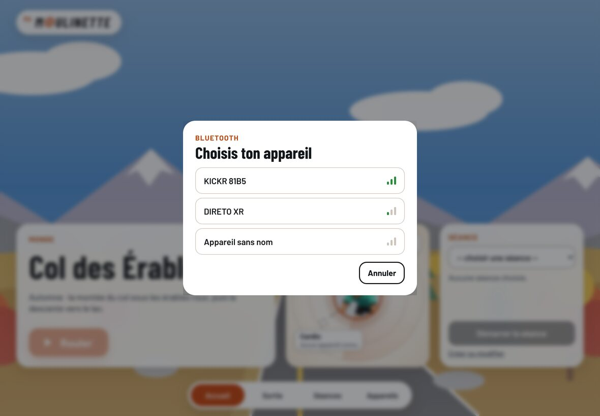
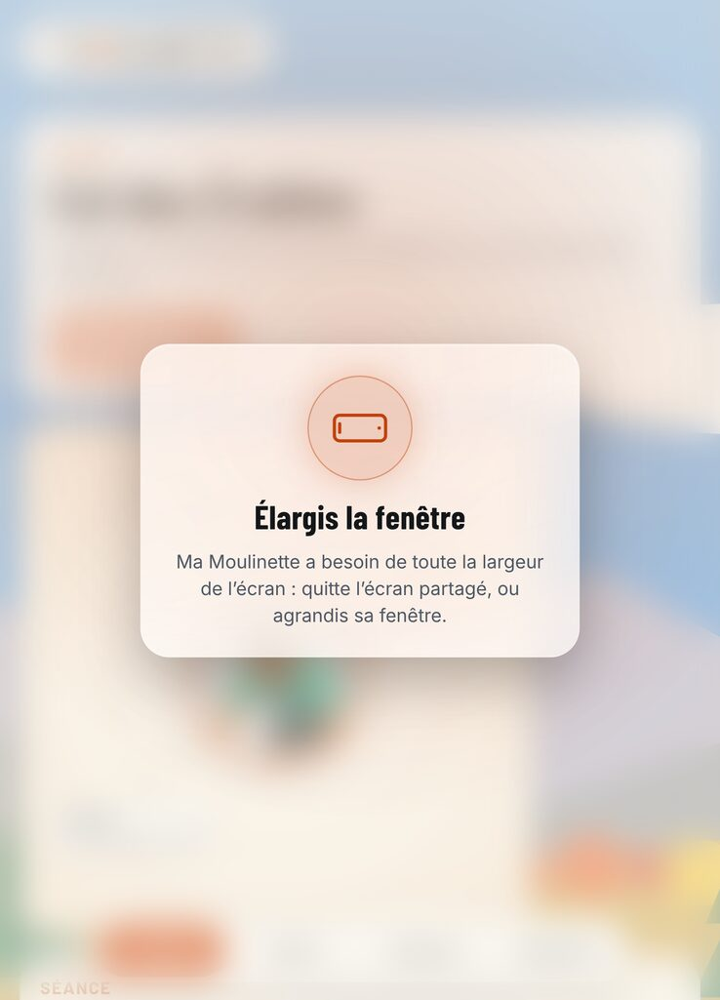

# Suivi de l'audit iPad du 17 novembre 2026

Tous les constats de [l'audit iPad](ipad.md) sont traités. Ce qui tourne dans la page est testé (tests unitaires) et vérifié dans Chromium aux tailles d'iPad. La partie native (Swift, Info.plist, projet Xcode) n'a pas été compilée : il n'y a ni Mac ni iPad ici. C'est le premier essai à faire, avant tout le reste.

| # | Constat | Correction | Vérifié ici |
|---|---|---|---|
| 1 | Guide d'installation affiché dans la coquille | La coquille compte comme installée (`isNativeShell()` dans `src/ui/app-shell.ts`) : ni guide, ni bouton plein écran. Règles sorties dans `shellHints`, testées | Coquille simulée (WebView sans API plein écran, pont Capacitor iOS) sur iPad et iPhone : plus de guide |
| 2 | Deux appareils en attente : le trainer jamais réveillé | Balayage partagé (`SharedScan`, `src/sensors/native-bluetooth.ts`) : chaque abonné reçoit les annonces ; un nouvel abonné relance le balayage, car le plugin oublie alors les appareils déjà vus ; le dernier qui part l'arrête | Test qui reproduit le plugin (un seul écouteur) : le trainer est réveillé, la ceinture qui se reconnecte n'arrête pas sa surveillance |
| 3 | Mise en veille pendant la sortie | Écran gardé allumé sur la Sortie et tant qu'une sortie tourne (`src/ui/keep-awake.ts`) : `isIdleTimerDisabled` dans la coquille (plugin de l'application), Screen Wake Lock dans les navigateurs, repris au retour au premier plan | Tests |
| 4 | Portrait et Split View sans issue | Coquille : iPad en paysage seulement, `UIRequiresFullScreen` (plus d'écran partagé). Safari sur iPad : une fenêtre haute sur un iPad couché demande d'« élargir la fenêtre », sans bouton plein écran inutile | Split View 590 × 820 simulé : texte « Élargis la fenêtre », pas de bouton |
| 5 | Hors ligne : page d'erreur dans la coquille | `WKAppBoundDomains` et `limitsNavigationsToAppBoundDomains` (service worker disponible dans la WKWebView) ; page embarquée `offline.html` (`server.errorPath`) au premier lancement sans réseau, qui rouvre l'application au retour du réseau. `npm run ios:sync` accorde les deux au serveur (`tools/ios/sync.mjs`, testé). Serveur de développement en clair : restriction levée | Tests du script |
| 6 | Connexion Strava refusée par Google dans la WebView | Session d'authentification système (`ASWebAuthenticationSession`, `ios/App/App/MoulinettePlugin.swift`). Le serveur rend `moulinette://auth?ticket=…`, un ticket à usage unique valable 2 minutes, que la page échange contre sa session (`POST /api/auth/redeem`, même origine et en-tête anti-CSRF). Même chemin pour le renouvellement depuis « Envoyer à Strava ». Strava retiré de `allowNavigation` : les liens Strava s'ouvrent dans Safari | Tests serveur (ticket, rejeu refusé, refus Strava, anti-CSRF) et client |
| 7 | Trainers repérés par leur seul nom invisibles | Sélecteur de l'application (`src/ui/device-chooser.ts`), alimenté par le balayage partagé sans filtre et trié avec les règles de Chrome (`matchesRequest` : services, nom exact, préfixe, exclusions). Les annonces d'un même appareil sont fusionnées : sur iOS, le nom arrive souvent seul, après les services | Tests (appareil retenu par son nom, KICKR CLIMB exclu quand son nom arrive, tri par signal, annulation) ; rendu à 1180 × 820 |
| 8 | Safari renvoie vers Chrome ou Edge | Sur iPad et iPhone, y compris iPad en mode ordinateur : « il faut l'application iOS » (`src/sensors/bluetooth-support.ts`) | Tests ; Safari iPad simulé |
| 9 | Cibles de moins de 44 px sur Séances ; `armv7` | Tablette tactile : annuler, rétablir, blocs précédent et suivant, actions du bloc, champs, recherche et boutons de la bibliothèque à 44 px ; onglets du profil à 34 px avec une marge invisible jusqu'à 44 px. `arm64` dans Info.plist | Plus aucune cible sous 44 px sur Séances à 1180 × 820, hors champ de recherche (42 px dans sa boîte de 44) |

WebGPU dans la WKWebView reste à constater sur l'appareil ; la ligne de statistiques de la Sortie dit quel rendu tourne.

| Sélecteur d'appareil | Split View dans Safari |
|---|---|
|  |  |

## Essai sur iPad, dans l'ordre

1. `npm run ios:sync`, ouvrir dans Xcode, compiler. À surveiller : les deux fichiers Swift ajoutés au projet à la main (`MoulinettePlugin.swift`, `MainViewController.swift`).
2. Premier lancement : pas de guide d'installation ; écran Appareils, « Bluetooth disponible. ».
3. Rechercher le trainer : le sélecteur de l'application s'ouvre, le KICKR apparaît. Puis le capteur cardiaque.
4. Quitter l'app, trainer et ceinture éteints ; relancer, puis allumer les deux : chacun se reconnecte sans clic.
5. Séance ERG de 10 minutes sans toucher l'écran : il reste allumé.
6. « Connect with Strava », y compris par « Continuer avec Google » : retour dans l'app, connecté.
7. Mode avion après un premier lancement : l'application s'ouvre (service worker). Désinstaller, mode avion, premier lancement : page « Pas de connexion », puis réseau rétabli : l'application s'ouvre.
8. Tourner l'iPad et tenter l'écran partagé : l'application reste en paysage, plein écran.
