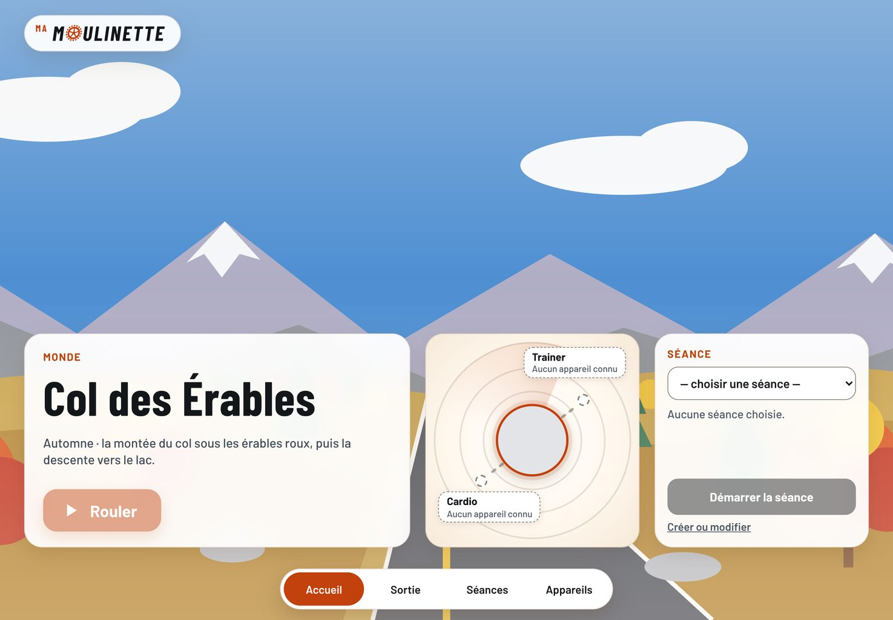
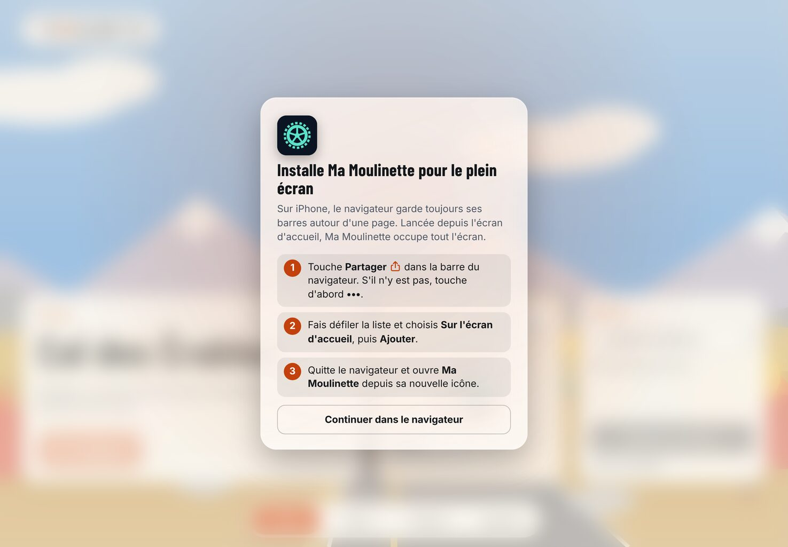
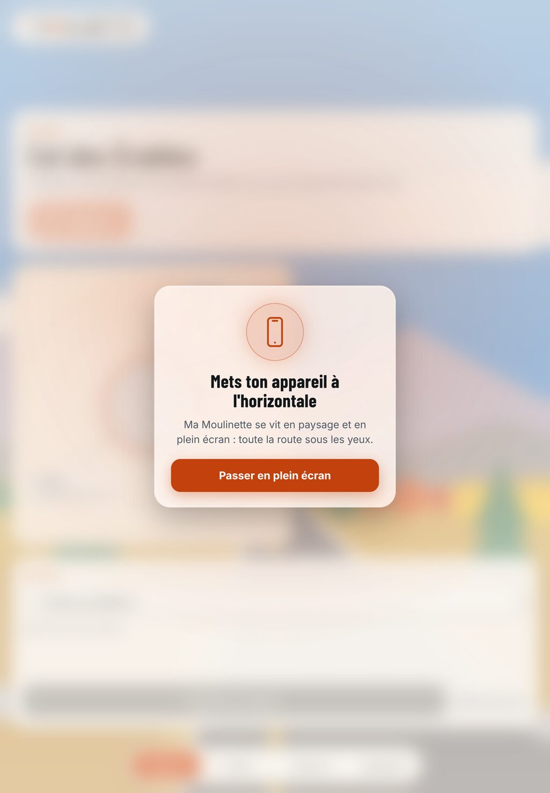
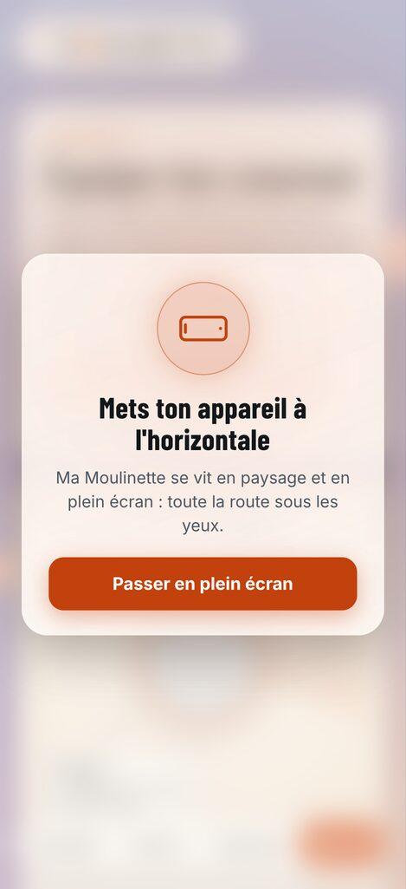

# Audit iPad, 17 novembre 2026

Commit audité : `7e9c992` (les fichiers en cause sont identiques sur `b9cad9e`).

Deux façons d'utiliser l'application sur iPad :

- **la coquille iOS** (`ios/`, Capacitor), seule à avoir le Bluetooth (pont natif `src/sensors/native-bluetooth.ts`) : c'est le vrai parcours iPad ;
- **Safari**, qui n'a pas Web Bluetooth : on peut naviguer et préparer des séances, mais pas rouler avec un trainer.

## Méthode et limites

- Mise en page : build de production servi par `tools/audit/serve.mjs`, mesures de `tools/audit/screens.cjs` (débordements, textes < 12 px, cibles tactiles, axe-core, erreurs console) sur 8 formats, **en plein écran** (pas de barres, comme dans la coquille) : iPad 10ᵉ/11ᵉ gén. 1180 × 820 et 820 × 1180, iPad Pro 11 1194 × 834, iPad 7ᵉ gén. 1080 × 810, iPad mini 1133 × 744 et 744 × 1133, Split View moitié (590 × 820) et tiers (375 × 820).
- Moteur : Chromium avec le profil iPad de Playwright (agent utilisateur, toucher, `pointer: coarse`). Ce n'est **pas WebKit** : les différences de rendu de Safari et de WKWebView ne sont pas couvertes.
- Coquille : simulée (WebView sans API plein écran) ; pont Bluetooth éprouvé par un test avec un faux plugin qui reproduit le comportement réel de `BleClient`. **Rien n'a été lancé sur un vrai iPad** ni avec un vrai trainer : pas de Mac ni d'appareil dans cet environnement.
- Les erreurs WebGPU de la console (`createBuffer … too large`, `Device Lost`) viennent du rendu logiciel du conteneur, pas de l'application.

## Ce qui marche

En paysage, sur tous les formats d'iPad : aucun débordement horizontal, aucun texte sous 12 px, aucune violation axe-core, navigation en pastille bien placée. Accueil, Appareils et Séances occupent bien l'écran (Séances défile verticalement, comme prévu).

## Constats, du plus grave au moins grave

### 1. Élevé : dans la coquille, le guide « Installe Ma Moulinette » s'affiche à chaque lancement

`src/ui/app-shell.ts` montre le guide d'installation quand l'écran est tactile, que l'API plein écran manque et que l'app n'est pas « installée » (`display-mode: standalone` ou `navigator.standalone`). Dans une WKWebView, aucun de ces deux signaux n'est vrai, et l'API plein écran n'existe que si l'app active `isElementFullscreenEnabled` (désactivé par défaut ; jamais exposé sur iPhone). Résultat simulé sur iPad et iPhone : le guide recouvre l'application native et lui demande de s'ajouter à l'écran d'accueil. Le texte parle en plus d'iPhone sur un iPad.

Correctif : considérer la coquille comme installée (`Capacitor.isNativePlatform()` dans `standalone()`), et ne pas afficher « Passer en plein écran » dans la coquille. À confirmer sur l'iPad dès le premier lancement.

### 2. Élevé : deux capteurs qui attendent leur signal en même temps, et le trainer n'est jamais réveillé

Au lancement, l'application retrouve le trainer et la ceinture cardio (`getDevices()`), puis, s'ils sont éteints, attend leur annonce Bluetooth (`waitUntilNearby` dans `src/sensors/gatt-device.ts`, sans délai maximal). Dans le pont natif, `watchAdvertisements()` lance un balayage `requestLEScan` par appareil. Or le plugin n'a **qu'un balayage et un écouteur** à la fois : le second `requestLEScan` remplace l'écouteur du premier, et le premier `stopLEScan` arrête tout.

Reproduit par un test (faux plugin au comportement de `BleClient`) : trainer et ceinture en attente, le trainer s'allume, aucune annonce ne lui parvient. Cas courant sur iPad : on ouvre l'app, puis on allume le trainer et on met la ceinture. Même chose après une coupure des deux (sortie de la pièce).

Correctif : un balayage partagé dans `NativeBluetooth` (un seul `requestLEScan`, annonces distribuées par identifiant, arrêt quand plus personne n'écoute). Ajouter ce cas aux tests de `native-bluetooth.test.ts`.

### 3. Élevé : l'iPad se met en veille pendant la sortie

Aucun verrou de veille dans le code (`wakeLock` absent). Pendant une séance ERG, on ne touche pas l'écran : l'iPad s'assombrit puis se verrouille au bout du délai réglé (2 à 5 min par défaut). La WebView est alors suspendue : l'enregistrement à 1 Hz, la sortie virtuelle et la reconnexion s'arrêtent.

Correctif : dans la coquille, empêcher la veille pendant la sortie (`UIApplication.isIdleTimerDisabled`, par exemple avec le plugin `@capacitor-community/keep-awake`) ; dans Safari, `navigator.wakeLock.request('screen')` (iPadOS 16.4 et plus), repris à chaque retour au premier plan.

### 4. Moyen : portrait et Split View, une invite bloquante sans issue

`Info.plist` accepte les quatre orientations sur iPad, et donc le multitâche (Split View, Slide Over, Stage Manager). L'application, elle, couvre tout l'écran d'une invite « Mets ton appareil à l'horizontale » dès que la fenêtre est plus haute que large. En Split View, tourner l'iPad ne sert à rien, et « Passer en plein écran » ne sort pas du partage d'écran. Sous l'invite, la Sortie descend à 4,7 px de texte au tiers d'écran.

| Portrait 820 × 1180 | Split View, tiers d'écran |
|---|---|
|  |  |

Correctif le plus simple, cohérent avec « Ma Moulinette se vit en paysage » : sur iPad, ne déclarer que les deux orientations paysage et ajouter `UIRequiresFullScreen` à `true` (plus de Split View). L'autre voie, prendre en charge le portrait sur iPad, est un chantier de mise en page.

### 5. Moyen : hors ligne, la coquille affiche une page d'erreur

La coquille charge l'application depuis le serveur (`server.url`), et le dossier `webDir` n'est jamais servi dans ce cas. Le service worker ne peut pas prendre le relais : dans une WKWebView, il n'est disponible que si l'app déclare ses domaines (`WKAppBoundDomains` dans `Info.plist`, et `limitsNavigationsToAppBoundDomains` côté Capacitor). Sans réseau au lancement, l'iPad affiche donc une erreur WebKit. À vérifier sur l'appareil.

Correctif : déclarer les domaines de l'application (et ceux de Strava, sinon la connexion ne s'ouvre plus dans la coquille), puis vérifier que `sw.js` s'enregistre.

### 6. Moyen : connexion Strava dans la WebView

`allowNavigation` garde la page de connexion Strava dans la coquille. Google refuse de se connecter dans une WebView intégrée (`disallowed_useragent`) : un coureur qui entre dans Strava par « Continuer avec Google » est bloqué. Apple recommande aussi `ASWebAuthenticationSession` pour ces connexions.

Correctif : ouvrir la connexion dans une session d'authentification système (`@capacitor/browser` ou un plugin dédié) et revenir dans l'app par un lien universel.

### 7. Moyen : le sélecteur natif ne voit pas les trainers repérés par leur seul nom

Le plugin n'accepte qu'un jeu de services ou un seul nom. Avec les filtres du trainer (FTMS, Cycling Power, FE-C, plus 40 préfixes de noms), `toPluginOptions` garde les services et abandonne les noms : un trainer qui n'annonce aucun de ces services dans sa publicité n'apparaît pas dans la liste, alors qu'il apparaît dans Chrome. Les exclusions (KICKR CLIMB, HEADWIND) sont aussi ignorées.

Correctif : un sélecteur dans l'application, alimenté par `requestLEScan` sans filtre et trié en JavaScript avec les mêmes règles que Chrome. À défaut, vérifier sur les trainers de la matrice de compatibilité.

### 8. Faible : dans Safari, le message renvoie vers Chrome ou Edge

Sur iPad, l'écran Appareils dit « Web Bluetooth indisponible ici (Chrome ou Edge, en HTTPS ou sur localhost) ». Sur iPadOS, Chrome et Edge utilisent WebKit et n'ont pas non plus Web Bluetooth : le conseil mène à une impasse. Il faudrait renvoyer vers l'application iOS.

### 9. Faible : divers

- Séances : 20 cibles sur 42 font moins de 44 px (annuler, rétablir, filtres de blocs), le minimum recommandé par Apple ; à reprendre si l'écran sert en roulant.
- `Info.plist` : `UIRequiredDeviceCapabilities` vaut encore `armv7` (modèle de Capacitor) ; `arm64` correspond aux appareils pris en charge.
- WebGPU dans la WKWebView n'est pas vérifié ; le repli WebGL2 existe.

## Plan d'action

| Priorité | Action | Fichiers |
|---|---|---|
| 1 | Coquille = installée : pas de guide d'installation ni de bouton plein écran | `src/ui/app-shell.ts` |
| 2 | Balayage Bluetooth partagé entre appareils, et test | `src/sensors/native-bluetooth.ts` |
| 3 | Empêcher la veille pendant la sortie (natif et Safari) | `src/main.ts`, plugin |
| 4 | iPad en paysage seulement, sans multitâche | `ios/App/App/Info.plist` |
| 5 | Domaines de l'app déclarés pour le service worker | `Info.plist`, `capacitor.config.ts` |
| 6 | Connexion Strava par session d'authentification système | `src/ui/account-chip.ts`, `worker/app.ts` |
| 7 | Sélecteur d'appareils dans l'app | `src/sensors/native-bluetooth.ts` |
| 8 | Message Safari iPad, cibles des Séances, `arm64` | — |

Après les points 1 à 4, un essai sur un vrai iPad avec le KICKR : premier lancement, reconnexion sans clic, une séance ERG de 10 minutes sans toucher l'écran, coupure du trainer.
