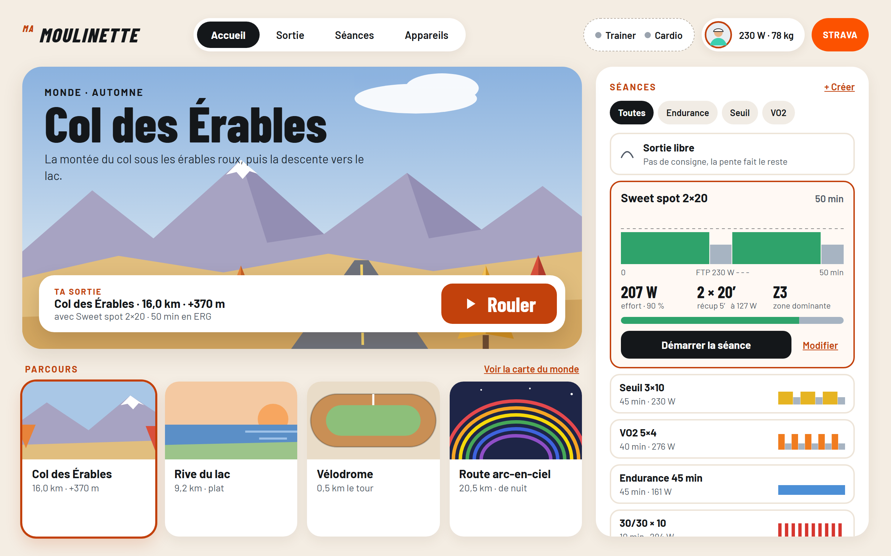
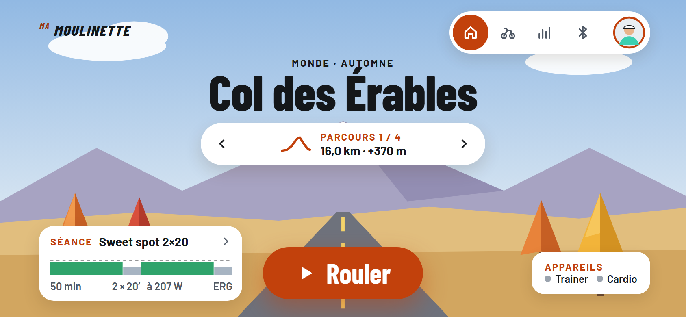
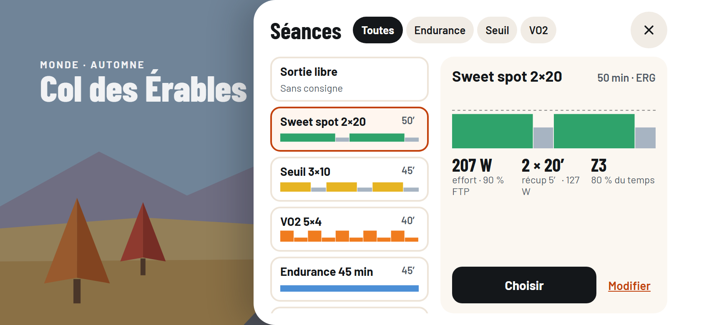

# Refonte de l'accueil

Spécification de la nouvelle page d'accueil, retenue le 19 novembre 2026. **Rien n'est codé** : ce fichier fixe la cible ; l'implémentation viendra dans une branche à part, qui mettra à jour [accueil-appareils.md](accueil-appareils.md) (section « Accueil »).

- Maquettes (claude.ai, canevas privé) : [Nouvel accueil](https://claude.ai/artifact/5r4xqLydvKmiC9kbHqHXc8). Trois propositions par format (D1 Affiche, D2 Tableau, D3 Lanceur ; M1 Partage, M2 Rail, M3 Essentiel), trois itérations sur D2 et M3, puis les versions retenues.
- Retenues : **D2.4 · Vignettes + séances** (ordinateur) et **M3.4 · Centré, séance détaillée** avec son panneau **M3.5** (iPhone en paysage).
- Thème inchangé : « Doux » (crème, cartes blanches, accent `#C2410C`, Barlow / Barlow Condensed), scènes SVG du monde, arbres à facettes.

| Ordinateur · D2.4 | iPhone · M3.4 | iPhone · M3.5, séances ouvertes |
|---|---|---|
|  |  |  |

## Pourquoi

- **Ordinateur** : le tiers haut n'était que du ciel, les trois cartes du bas (monde, radar, séance) étaient de largeurs et de rôles inégaux, la séance vide (« Aucune séance choisie ») occupait une carte entière.
- **Téléphone** : la pastille de navigation en bas et les trois grosses cartes remplissaient l'écran, l'ensemble paraissait grossier.
- Partout : il fallait toucher « Rouler » pour découvrir les parcours ; le radar prenait une tuile pour dire « non connecté ».

## Décisions

| Date | Décision | Pourquoi |
|---|---|---|
| 2026-11-19 | Ordinateur : **D2.4**, grille en tableau qui remplit l'écran. Face à D1 (paysage + panneau latéral) et D3 (lanceur plein écran, rail à gauche). | Aucun vide, chaque carte a un rôle, tout se choisit sans fenêtre. |
| 2026-11-19 | Parcours en **vignettes illustrées** (D2.2), toujours visibles sous le monde. | Le choix du parcours devient la première chose qu'on voit, sans ouvrir le menu « Rouler ». |
| 2026-11-19 | Coureur, appareils et Strava en **pastilles dans l'en-tête** (idée de D2.3). | Libère la colonne de droite ; le radar n'a plus besoin d'une tuile sur l'accueil (il reste sur l'écran Appareils). |
| 2026-11-19 | La colonne de droite devient une **liste de séances détaillée**. | La séance était le point le moins lisible : un menu déroulant et un profil sans chiffres. |
| 2026-11-19 | Téléphone : **M3.3 Centré**, sans pastille de navigation en bas ; navigation en icônes en haut à droite. Face à M1 (écran partagé), M2 (rail à gauche), M3.1 (barre de départ), M3.2 (parcours en puces). | Le décor respire, une seule action évidente (« Rouler »), plus de cartes empilées. |
| 2026-11-19 | Téléphone : la pastille « Séance » devient une **carte avec profil et chiffres** (M3.4), et ouvre un **panneau latéral** de séances (M3.5). | Rendre l'aperçu des séances plus complet sans charger l'écran d'accueil. |

## Ordinateur · D2.4

- **En-tête** (52 px) : marque à gauche ; navigation en pastille (Accueil, Sortie, Séances, Appareils ; page courante en noir) ; à droite trois pastilles : **appareils** (point d'état Trainer, Cardio, bordure pointillée tant que rien n'est connecté, vers Appareils), **coureur** (médaillon, « 230 W · 78 kg », ouvre la fiche du coureur), **Strava**.
- **Grille** de 12 colonnes, 2 rangées (`1fr` et 250 px), 20 px d'écart :
  - **Monde** (8 colonnes, rangée 1) : la scène dans une carte arrondie, le titre (« MONDE · AUTOMNE », nom en 72 px, phrase) en haut à gauche sur le ciel. En bas, une barre blanche **« Ta sortie »** résume le choix (« Col des Érables · 16,0 km · +370 m », « avec Sweet spot 2×20 · 50 min en ERG ») à côté du bouton **Rouler**, seul bouton orange de l'écran.
  - **Parcours** (8 colonnes, rangée 2) : quatre vignettes illustrées (Col des Érables en automne, Rive du lac au couchant, piste du Vélodrome, Route arc-en-ciel de nuit), nom et chiffres dessous ; la choisie est cerclée d'orange. Lien « Voir la carte du monde ».
  - **Séances** (4 colonnes, sur les deux rangées) : voir ci-dessous.

### Colonne des séances

1. Titre « SÉANCES » et lien « + Créer » (vers l'éditeur).
2. Filtres en puces : Toutes, Endurance, Seuil, VO2.
3. **Sortie libre** en premier choix.
4. La **séance choisie, dépliée** : nom et durée ; profil par zones avec la ligne de FTP en pointillé ; trois chiffres (puissance de l'effort et % FTP, structure « 2 × 20′ » avec récupération, zone dominante) ; barre du temps passé par zone ; **Démarrer la séance** (bouton noir, pour ne pas concurrencer « Rouler ») et « Modifier ».
5. Les autres séances, repliées : nom, « durée · puissance cible », mini-profil. La liste défile dans la carte.

Les watts sont calculés avec la FTP du coureur.

## iPhone en paysage · M3.4 et M3.5

Plein écran 844 × 390 (voir [CLAUDE.md](../../CLAUDE.md)). Marges de 44 à 48 px sur les côtés pour l'encoche, 20 px en bas pour la barre d'accueil.

- **Scène nette** en fond (pas le flou de la décision du 18/11 : il n'y a plus de cartes qui la morcellent).
- En haut : la marque à gauche ; à droite une **pastille d'icônes** (Accueil, Sortie, Séances, Appareils, 44 × 44, `aria-label`) suivie du médaillon du coureur.
- Au centre : « MONDE · AUTOMNE », le nom du monde (60 px), puis un **sélecteur de parcours** ‹ › : profil, « PARCOURS 1 / 4 », « 16,0 km · +370 m ».
- En bas au centre : **Rouler**, pilule orange de 64 px.
- En bas à gauche : la **carte Séance** (250 px) : nom, profil par zones avec ligne de FTP, « 50 min · 2 × 20′ à 207 W · ERG ». Elle ouvre le panneau M3.5.
- En bas à droite : la pastille **Appareils** (points Trainer et Cardio).

**M3.5 · Panneau des séances** : il glisse depuis la droite (540 px), le monde reste visible assombri à gauche. En-tête : « Séances », filtres, bouton Fermer. Deux colonnes : la liste (Sortie libre puis chaque séance avec sa durée et un mini-profil) et le détail de la séance sélectionnée (profil, chiffres, **Choisir**, « Modifier »).

## Ce qui reste à décider ou à faire

- **Séances modèles** : les maquettes montrent Sweet spot 2×20, Seuil 3×10, VO2 5×4, Endurance 45 min et 30/30 × 10, construites d'après les blocs prédéfinis de l'éditeur (`presets.ts`). L'application ne livre pas encore de séances toutes prêtes : sans elles, la colonne est vide au premier lancement.
- **Filtres** : l'application ne classe pas les séances par type ; il faut déduire la catégorie (zone dominante, par exemple) ou la stocker.
- **Rotation des scènes** : la scène change toutes les minutes ; le titre « Monde » doit-il la suivre, ou rester sur le monde du parcours choisi ?
- **Écrans intermédiaires** : iPad, ordinateur portable 1024 × 640, et téléphone en portrait restent à dessiner.
- Le menu « Rouler » (choix du parcours) disparaît de l'accueil ; vérifier qu'aucun autre chemin n'en dépend.
