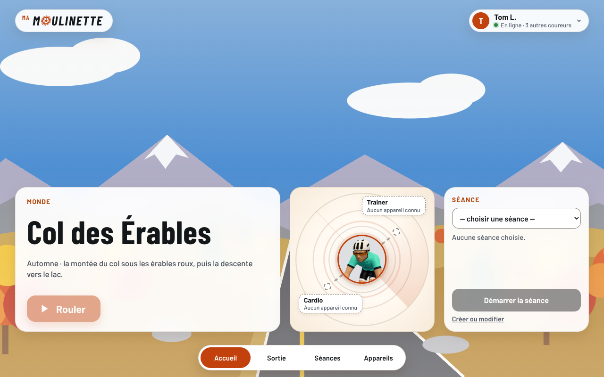
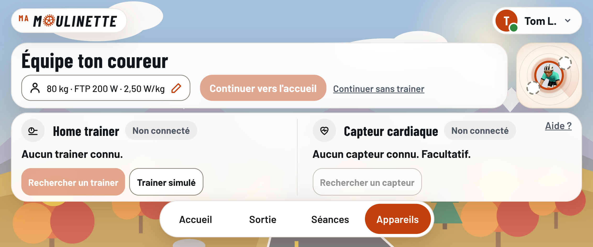
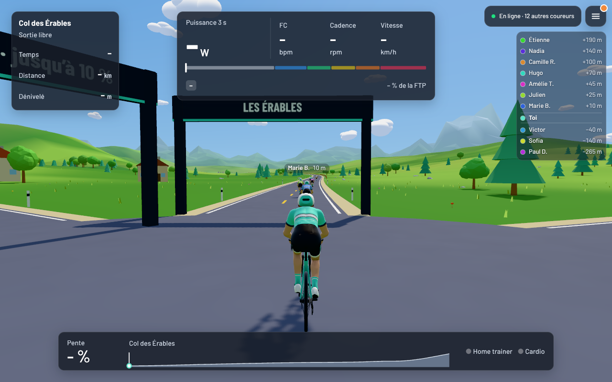
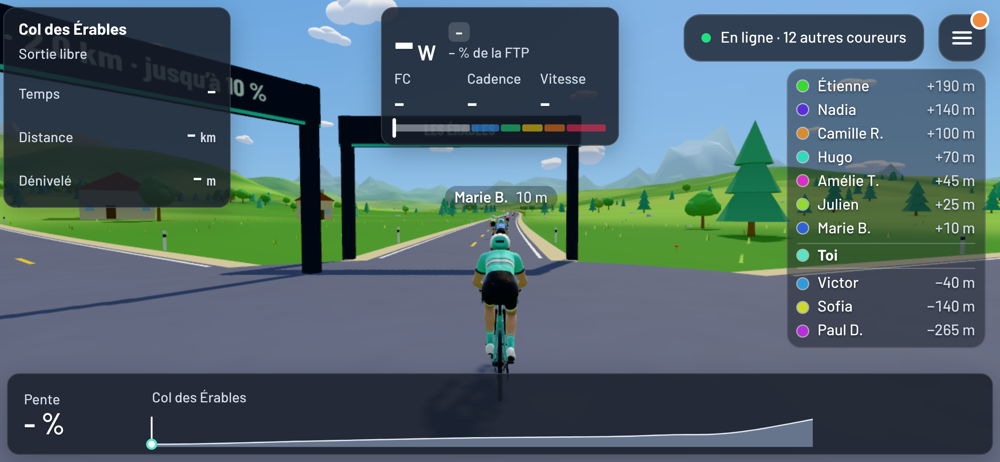

# Compte du coureur

Référence permanente du compte : connexion avec Strava, nom montré aux autres, mode sans compte. Toute évolution part de ce fichier et le met à jour.

- Code : [`src/ui/account-chip.ts`](../../src/ui/account-chip.ts) (pastille, menu, boîte du nom), [`src/ui/account.css`](../../src/ui/account.css) (style), [`src/net/account.ts`](../../src/net/account.ts) (appels au serveur) ; côté serveur [`src/server/accounts.ts`](../../src/server/accounts.ts) et [`src/server/user-strava.ts`](../../src/server/user-strava.ts).
- Branchement : fin de [`src/main.ts`](../../src/main.ts) : la pastille s'ajoute à chaque `.home-top` (Accueil, Appareils, Séances), et la connexion à la salle temps réel suit l'état du compte.
- Bouton Strava : fichiers officiels de Strava, **non retouchés** ([`public/strava/`](../../public/strava/)), tirés de l'archive des [règles de marque de l'API Strava](https://developers.strava.com/guidelines/) (révision du 29 septembre 2025).

## Décisions

| Date | Décision | Pourquoi |
|---|---|---|
| 2026-11-16 | Le compte est **facultatif**. Sans compte, on roule seul et l'export FIT reste là ; l'envoi à Strava et les autres coureurs demandent un compte. | L'application doit marcher sans serveur et sans compte. Le multijoueur et l'envoi à Strava ont besoin de savoir qui roule. |
| 2026-11-16 | Le compte vit **en haut à droite** des écrans plein écran, en face de la marque, à sa hauteur. Pas dans les cartes, pas d'écran de connexion au lancement. | La place était libre sur les trois écrans. Rien ne bloque le chemin Appareils → Accueil → Rouler, et le compte reste visible partout. |
| 2026-11-16 | Sans compte, le **bouton officiel « Connect with Strava » orange**, dans une pastille de verre avec « Rouler avec les autres / Sans compte : seul, export FIT ». | Strava impose ses fichiers, sans retouche, et un lien vers `strava.com/oauth/authorize` (notre `/api/auth/login` y redirige). La ligne dit ce qu'on gagne, et ce qu'on garde sans compte. |
| 2026-11-16 | Connecté : une **pastille** (initiale sur l'accent, nom, « En ligne · 3 autres coureurs ») qui ouvre un menu : « Changer de nom », « Se déconnecter », et la mention « Compatible with Strava ». | Même forme que la marque. L'état en ligne dit tout de suite si les autres nous voient. La mention est l'une des deux formules permises par Strava. |
| 2026-11-16 | À la première connexion, une **boîte « Comment les autres te voient »** propose « Prénom I. » d'après Strava. Le coureur valide ou change ; « Plus tard » le laisse invisible des autres. | Les conditions de l'API Strava interdisent de montrer à un autre utilisateur les données d'un athlète. Le nom affiché devient une donnée de Ma Moulinette, choisie par le coureur. Ni photo ni activité Strava n'est montrée. |
| 2026-11-16 | **Android : connexion par l'app Strava.** Le bouton mène à `strava.com/oauth/mobile/authorize`, que l'app Strava (75.0 ou plus) intercepte : déjà connecté, on n'a qu'à toucher « Autoriser ». Si l'essai reste sans session (l'app a rendu la main à un autre navigateur que celui de Ma Moulinette), le toucher suivant, dans les 15 minutes, passe par la page web de Strava. iPhone et ordinateur : page web. | Demande de Tom : profiter de la session de l'app Strava. Sur iPhone, l'app Strava ne s'ouvre que depuis une app native (`strava://`, fenêtre de connexion système) : ce sera pour la coquille iOS. |
| 2026-11-16 | Le **menu du compte passe au-dessus des cartes** : l'en-tête des écrans a son propre niveau (`z-index: 20`). Dans le **rail de Séances** (téléphone couché), seule l'initiale tient ; le menu s'ouvre à sa droite, vers le haut ; sans compte, rien dans le rail. | Sur iPhone couché en plein écran (390 px de haut), le menu passait derrière la carte Séance. Le rail fait 54 px : la pastille débordait, et le bouton officiel Strava (198 px) n'y tient pas. |
| 2026-11-16 | **Téléphone couché** : seulement le bouton Strava (40 px de haut, comme la marque), ou la pastille réduite à l'initiale et au nom, avec un point vert sur l'initiale quand on est en ligne. | La hauteur est rare ; la phrase d'explication reste sur grand écran. |

## États

| État | Ce qu'on voit | Envoi à Strava | Autres coureurs |
|---|---|---|---|
| Pas de serveur de comptes (build statique, Vite seul) | Rien | Non : export FIT | Non |
| Sans compte | Bouton « Connect with Strava » et la phrase | Non : export FIT (le bouton « Envoyer à Strava » est caché, le récapitulatif ne propose que le FIT) | Non |
| Connecté, nom à valider | Pastille « Nom à valider » ; la toucher rouvre la boîte du nom | Oui | Non : la salle le refuse tant que le nom n'est pas validé |
| Connecté | Pastille, état en ligne | Oui, sur son propre compte Strava | Oui |

États de la ligne en ligne (`worldLine`) : « En ligne · seul pour l'instant », « En ligne · N autres coureurs », « Connexion… », « Connexion perdue, nouvel essai… », « Connecté sur un autre appareil », « Mise à jour : recharger la page », « Session expirée », « Hors ligne ».

## Autres coureurs sur la Sortie

- Code : [`src/render/others.ts`](../../src/render/others.ts) (coureurs dans la scène), [`others-model.ts`](../../src/render/others-model.ts) (voie, noms sans chevauchement), [`src/ui/rider-tags.ts`](../../src/ui/rider-tags.ts) (étiquettes et pastille).
- Les 16 plus proches, à moins de 220 m, sont dessinés ; leur nom et leur distance s'affichent jusqu'à 140 m, six étiquettes au plus, le plus proche gardant la sienne quand deux se recouvrent. Teinte du maillot et du vélo selon la place dans la salle.
- Encart des coureurs proches, au bord droit sous le bouton du menu (sur téléphone couché, à gauche de la colonne de boutons) : jusqu'à **7 coureurs devant**, « Toi », puis **3 derrière**, de l'avant vers l'arrière, avec un point de la couleur de leur maillot et l'écart à vol d'oiseau (+45 m, −140 m ; par 5 m, puis en km). « Devant » se décide par le cap du joueur ; portée 1,5 km. Les pistes des coureurs n'ont pas de repère commun : un écart de trajet n'existe pas. Verre léger, sans toucher. Code : [`near-riders.ts`](../../src/ui/near-riders.ts), calcul dans `others-model.ts` (`nearby`).
- **Aspiration** : la ligne « Toi » affiche « Aspiration N % » en vert quand un coureur juste devant (même file, moins de 25 m) épargne de l'air ; détails et modèle dans [salle.md](salle.md). Au-delà de 33 coureurs, la salle n'envoie à chacun que ses 32 voisins les plus proches (1,5 km), de quoi remplir l'encart.
- Étiquettes de nom : fond à 34 % d'opacité et ombre portée du texte, pour rester discrètes (72 % avant le 17 novembre).
- Pastille à gauche du bouton du menu : « En ligne · N autres coureurs », cachée sans compte. Texte de 13 px (le minimum du projet est 12 px).

## Captures

Développement local, 16 novembre 2026 (connexion de développement et trois robots, `npm run bots`).

| | |
|---|---|
| Sans compte, ordinateur |  |
| Sans compte, téléphone couché |  |
| Connecté, ordinateur |  |
| Connecté, téléphone couché (écran Appareils) |  |
| Menu du compte |  |
| Autres coureurs sur la Sortie, ordinateur (12 robots immobiles : 8 devant, 4 derrière) |  |
| Autres coureurs sur la Sortie, téléphone couché 844 × 390 (mêmes robots), encart collé au bord |  |
| Idem avec les commandes de séance affichées : l'encart passe à leur gauche |  |
| Boîte du nom |  |

## Développement

Sans identifiants Strava, `DEV_LOGIN=1` dans `.dev.vars` remplace le bouton Strava par « Connexion de développement » (un nom suffit). Jamais en ligne.
