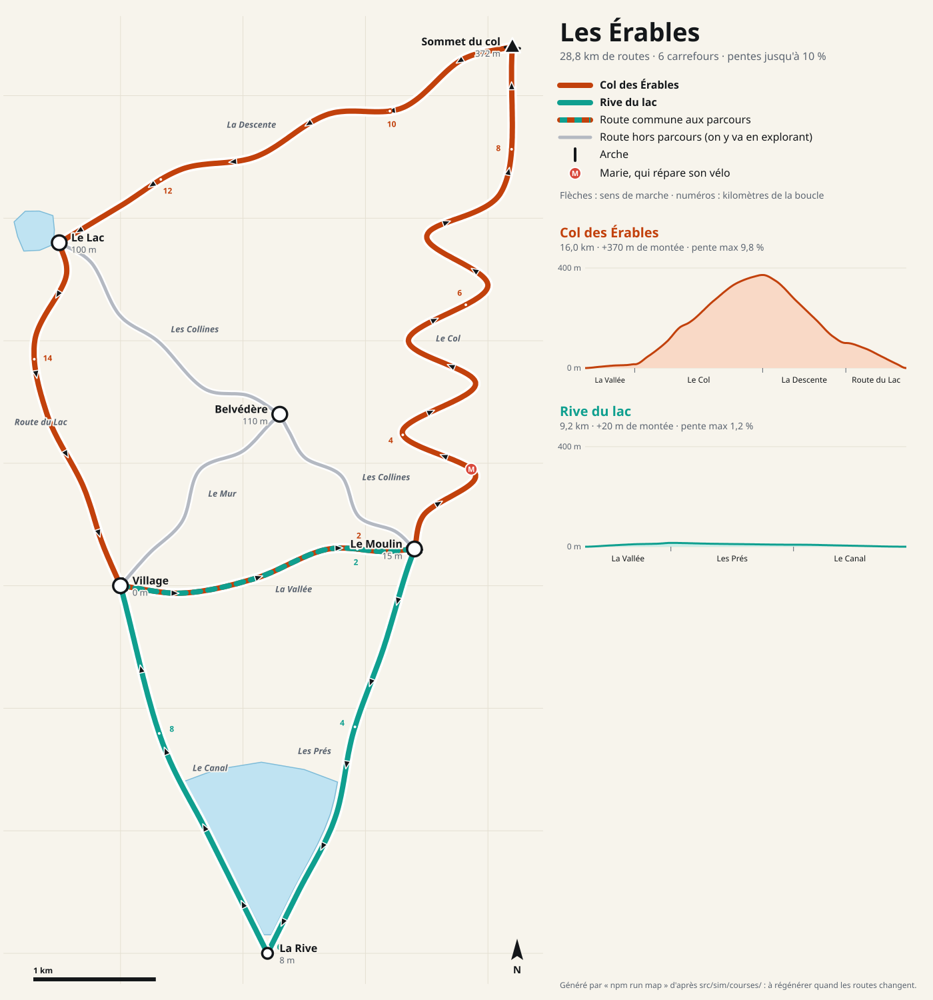

# Parcours : réseau routier et ressenti de la pente

Spécification permanente. Créée le 14 novembre 2026, quand la boucle de 6 km est remplacée par un réseau de routes ; deux parcours ajoutés le même jour.

## Pourquoi

La boucle de 6 km (une montée à 5 %, sa descente, sur un cercle) ne donnait ni variété ni exploration, et ses 5 % se voyaient à peine. Le but : un monde de 20 km et plus, des routes qui se croisent, des pentes jusqu'à 10 %, et une montée que l'on sent à l'image.

## Le modèle : un réseau statique, un trajet qui avance

- **`RoadNetwork`** ([`src/sim/network.ts`](../../src/sim/network.ts)) : des nœuds (carrefours) et des routes. Une route est une courbe en plan (x vers l'est, z vers le sud, en m) et un profil d'altitude lisse (interpolation monotone) ; les altitudes d'extrémité sont celles des nœuds, donc le réseau est continu par construction. Les 20 derniers mètres de chaque extrémité sont plats : la pente envoyée au trainer ne saute pas à un carrefour.
- **`Journey`** ([`src/sim/journey.ts`](../../src/sim/journey.ts)) : les routes réellement empruntées, mises bout à bout. Pour la simulation c'est un parcours à distance monotone (`altitudeAt`, `gradeAt`), exactement ce que `Ride`, l'export FIT et le récapitulatif consomment : rien d'autre n'a changé côté simulation. L'interface commune est `Course` ([`src/sim/course.ts`](../../src/sim/course.ts)), que remplit aussi l'ancienne `Route`.
- **`validateNetwork`** : le contrôle de cohérence exigé par les tests. Pente maximale 10 % (plafond du KICKR ROLLR), aucun cul-de-sac, routes non voisines éloignées d'au moins 60 m, au moins 35° entre deux routes d'un carrefour, route d'au moins 150 m.

### Le monde des Érables et ses deux parcours

Un seul réseau de 28,8 km (6 carrefours, 9 routes), des parcours qui s'y superposent. Données : [`src/sim/courses/col-des-erables.ts`](../../src/sim/courses/col-des-erables.ts), avec les repères de décor (arches, clôtures, Marie).

La carte est générée d'après les données du jeu : `npm run map` la réécrit quand les routes changent ([`network-map.ts`](../../src/sim/network-map.ts)).

Un **parcours** (`CourseDef`) est une boucle recommandée : une suite de routes bout à bout, qui se referme au départ. Le cycliste peut la quitter à chaque carrefour, mais c'est sa route qui est proposée d'office (et que le profil du HUD annonce) ; sans parcours, on irait tout droit. Les routes d'un parcours se parcourent dans leur sens de définition.

| Parcours | Boucle | Longueur | Montée | Pente max |
|---|---|---|---|---|
| **Col des Érables** (montagne) | Vallée, Col, Descente, Route du Lac | 16,0 km | +370 m | 9,8 % |
| **Rive du lac** (plat) | Vallée, Prés, Canal | 9,2 km | plat (moins de 40 m) | moins de 2 % |

Les deux parcours **se croisent** : ils partagent La Vallée et passent par les mêmes carrefours, le Village et surtout le Moulin, où l'on peut passer de l'un à l'autre. Les autres routes (Les Collines, Le Mur) ne sont dans aucun parcours : on les prend en explorant.

Ajouter un parcours : écrire ses routes dans les données (elles doivent passer `validateNetwork`), puis une entrée `courses` dont la suite de routes s'enchaîne ; le constructeur de `RoadNetwork` refuse une boucle qui ne se referme pas. Le monde 3D ne change pas.

**Choix.** C'est **« Rouler » qui ouvre le menu de choix du parcours** : la carte « Monde » de l'accueil n'a pas la place d'un sélecteur (sur un iPhone en paysage elle ne fait que 300 px de large), alors que le menu prend celle dont il a besoin. Une boîte de dialogue avec une grande touche par parcours (nom, longueur et montée, description, profil d'altitude à l'échelle commune du réseau), la carte du réseau à droite, et « Partir » qui lance la sortie. Le parcours retenu est gardé d'une visite à l'autre ; l'accueil en affiche le nom, la description et la scène qui lui ressemble. Si une sortie est déjà en cours, « Rouler » la reprend sans menu : on ne change pas de parcours en route (ce serait repartir du village). Une sortie repart du début du parcours choisi, et « Démarrer la séance » prend le parcours retenu. Code : [`course-picker.ts`](../../src/ui/course-picker.ts), logique dans [`course-selection.ts`](../../src/ui/course-selection.ts).

**Carte.** Dans le menu, une miniature du réseau : le parcours retenu en couleur, l'autre en retrait, les routes hors parcours en gris. Un clic l'ouvre en grand ([`course-map.ts`](../../src/ui/course-map.ts)) : noms et altitudes des carrefours, kilomètres de la boucle, sens de marche, Marie, et le profil d'altitude du parcours. Fermer : bouton, Échap ou clic sur le fond. La hauteur du dessin suit celle de la fenêtre (520 à 760 px) et la boîte défile en dessous. Les cartes viennent de [`network-map.ts`](../../src/sim/network-map.ts), les mêmes fonctions que la planche ci-dessus.

## Carrefours

- Annoncé **250 m** avant (`ANNOUNCE_M`). Le choix se **verrouille 40 m** avant le nœud (`LOCK_M`), plus que la fenêtre de lissage de la pente (25 m) : la pente envoyée au trainer ne voit jamais une route encore indécise.
- Sans choix, on suit **la route du parcours** (marquée `onCourse`) ; hors parcours, on va **tout droit** (l'écart de cap le plus petit). Le trajet en avant (porte d'intervalle, profil du HUD) suit le choix en cours, sinon le tout droit, sans rien valider à la place du cycliste.
- Chaque option donne nom, longueur, pente moyenne, montée et direction (flèche à huit sens selon l'écart de cap : tout droit, biais, angle droit, épingle).
- **Saisie** : touches du panneau « Carrefour » du HUD (cibles de 56 à 64 px), ou flèches gauche et droite qui glissent la sélection d'une route à l'autre. Pas d'effet pendant une boîte de dialogue ni dans un champ de saisie.
- Le coin est arrondi par un arc de 12 m de rayon (`CORNER_M`) : le cycliste tourne, il ne pivote pas. L'altitude et la distance n'en sont pas touchées.

## Le monde 3D

Le monde se déduit du réseau ([`src/render/world-layout.ts`](../../src/render/world-layout.ts)) : où est la route la plus proche, quelle est la hauteur du sol.

- **Sol** : sous la route et ses abords, l'altitude de la route (avec un creux de 25 cm sous la chaussée pour qu'elle reste au-dessus du maillage). Au loin, un relief fait de « versants » : chaque point de route soutient un versant de pente bornée (12 % près, 35 % au pied). Les collines montent vers le sommet et la vallée reste en contrebas. S'y ajoute un **relief propre** au pays, indépendant des routes : des croupes qui montent quand on s'éloigne de la chaussée (nul à 70 m d'une route, entier à 650 m), hautes de 100 m en plaine et de 200 m autour du col. Sans lui, le sol redescendait de chaque côté de toute route et le pays se lisait comme un plateau. Règle tenue par les tests : à moins de 250 m d'une route, jamais plus de 50 % de pente (pas de mur au bord de la chaussée ; 45 % mesurés) ; plus loin, jamais de paroi verticale (52 % mesurés).
- **Morceaux** ([`src/render/terrain.ts`](../../src/render/terrain.ts)) : 128 m de côté, maille de 4 m près d'une route et du cycliste, 16 m ailleurs, jupe de 6 m contre les fissures, construits et libérés autour du cycliste (au plus 2 par image). Un relief lointain grossier couvre tout le réseau ; c'est un **minorant** du vrai sol (minimum sur le voisinage de chaque sommet), sinon son interpolation recouvre l'entaille de la route dans un versant.
- **Décor** ([`src/render/decor.ts`](../../src/render/decor.ts)) : arbres et rochers semés par morceau, avec un générateur propre à chaque morceau (le même monde à chaque chargement), rejetés sur la chaussée et sur les pentes raides, plus rares avec l'altitude (limite des arbres vers 230 à 340 m).
- **Forêts et prés** ([`src/render/vegetation.ts`](../../src/render/vegetation.ts)) : une carte du couvert forestier, en grandes masses de 300 à 800 m (40 % du pays). La forêt est dense, le pré presque nu, avec quelques arbres isolés au bord des routes. Les essences vont par bois entiers (sapins ou feuillus), les sapins dominent en altitude. Le sol lit la même carte : il s'assombrit sous la forêt, ce qui la montre de loin avant que ses arbres ne soient dessinés ; les pentes raides sont en roche.
- **Trois niveaux de détail par essence**, triés à chaque fois que le cycliste avance de 16 m : les arbres à moins de 105 m portent une ombre ; jusqu'à 260 m ils gardent leur forme complète sans ombre ; au-delà c'est une silhouette de quelques triangles. Avant, chaque arbre était redessiné dans les deux passes d'ombre où qu'il soit (970 000 triangles sur 2,1 millions au départ). Résultat : quatre fois plus d'arbres (7 700 au départ contre 1 800) pour moins de triangles (1,67 million contre 2,13).
- **Horizon** ([`src/render/world.ts`](../../src/render/world.ts)) : la chaîne de montagnes suit la boîte du réseau en rectangle arrondi (un cercle la laissait deux fois plus loin sur les petits côtés), en deux plans : contreforts boisés, puis sommets découpés jusqu'à 1 800 m, enneigés au-dessus de 880 m. De gros cumulus sont posés derrière la ligne de crête. La caméra porte à 20 km.
- **Routes** : un ruban par route, une plaque d'asphalte de 12 m à chaque carrefour, tirets et lignes arrêtés 12 m avant, bas-côté sableux en bande.

### Lacs

Deux lacs, décrits dans les données du parcours (`water` : un niveau et un contour) :

- le **lac de la Rive** (niveau 2,5 m), dans la boucle de la Rive du lac : Les Prés longent sa rive est, Le Canal sa rive ouest sur 1,5 km. Son contour suit ces deux routes à 25 à 50 m ;
- le **lac des Érables** (niveau 97 m), sur un replat à l'ouest du carrefour du Lac.

Le terrain se creuse dedans (fond à 4 m), sort de l'eau par une grève de sable, et tient une berge d'au moins 1,2 m au-dessus de la surface : un lac perché garde son bord. Entre une route et un lac, le talus descend de la chaussée à la ligne d'eau. Un relief haut au bord de l'eau y descend en pente douce (30 %), sans falaise. La surface est une grille plane réduite aux mailles qui touchent l'eau : claire près de la rive, sombre au large, teintée par le ciel aux angles rasants, avec des vaguelettes qui accrochent le soleil. `validateNetwork` refuse une route à moins de 18 m d'une rive, ou à moins de 1 m au-dessus d'un lac voisin.

**Le canal** prolonge le lac de la Rive le long de la seconde moitié de la route du Canal, jusqu'au Village : trois biefs de 12 m de large, à 20 m de l'axe de la route, chacun plus bas que le précédent (0,9 m, −0,45 m, −1,1 m) comme entre deux écluses. Ce sont des plans d'eau comme les lacs, marqués `kind: 'canal'` : leur tracé reste net (pas d'ondulation de rive) et leur berge est raide (3 m au lieu des 14 m de grève). Les écluses elles-mêmes ne sont pas construites.

Les lacs et le canal sont dessinés sur la carte des parcours (`npm run map`, [`network-map.ts`](../../src/sim/network-map.ts)), sous les routes.

### Lieux

Chaque carrefour nommé porte un lieu (`place` dans les données), construit par [`src/render/places.ts`](../../src/render/places.ts) en formes simples à facettes, fondues en un maillage par lieu :

| Carrefour | Ce qu'on y trouve |
|---|---|
| Village | une église à clocher et onze maisons |
| Le Moulin | un moulin à vent dont les ailes tournent, deux fermes, des meules de foin |
| Sommet du col | le panneau « Col des Érables, 372 m », un refuge, des cairns, des névés |
| Belvédère | une table d'orientation, un garde-corps, deux bancs |
| La Rive | un ponton, quatre barques, deux cabanes de pêcheur |
| Le Lac | un ponton, une barque, un banc |

Les emplacements sont tirés au sort autour du carrefour (le même tirage à chaque chargement), à l'écart des routes, de l'eau et des pentes. Le décor ne plante rien sur l'emprise des bâtiments.

### Les érables du Col

Un repère `grove` borde Le Col d'érables roux, orangés et dorés, du pied de la montée (120 m) à la limite des arbres (3 700 m), jusqu'à 160 m de la route ; le sol y prend la teinte des feuilles tombées. C'est ce qui donne son nom au col et le distingue des autres routes.

### Bord de route

[`src/render/roadside.ts`](../../src/render/roadside.ts) : un piquet blanc à bande sombre tous les 50 m des deux côtés, une borne à tête jaune à chaque kilomètre, et à chaque carrefour un poteau dont les flèches nomment les routes qui en partent, avec leur longueur. Le décor sème en plus des touffes d'herbe et des fleurs dans les 40 m autour des routes, dessinées à moins de 90 m du cycliste : c'est ce qui défile au plus près et donne la vitesse. La chaussée a un grain (plaques larges et grain fin).

Deux éléments se déduisent du tracé, par [`src/sim/road-features.ts`](../../src/sim/road-features.ts) :

- **Panneaux de pente** : un panneau brique au pied de chaque rampe, à droite de celui qui monte, avec la pente moyenne réelle (celle du HUD et du home-trainer, pas la pente exagérée à l'image) et la longueur : « 7 % sur 4,9 km » au pied du Col. Une rampe est un tronçon d'au moins 250 m dont la pente lissée sur 100 m dépasse 4 % ; deux rampes de même sens séparées par moins de 300 m de replat n'en font qu'une. Le réseau en compte sept.
- **Parapets** : des blocs de pierre à couronnement clair, bout à bout, à l'extérieur de chaque virage de moins de 60 m de rayon, 20 m avant et après. Ce sont les six virages serrés du Col ; le parapet y remplace les piquets de son côté. Pas encore de mur de soutènement côté amont.

### Ce qui bouge

Les couronnes des arbres complets se balancent au vent, par vagues qui traversent le pays ; les nuages dérivent autour du centre du réseau ; de grandes ombres de nuages glissent sur le sol et la route (décoratives : elles ne suivent pas les nuages dessinés) ; l'eau ondule ; les ailes du moulin tournent. Tout se calcule dans la carte graphique, sauf les ailes et la dérive (une rotation par image).

### Lumière et couleur

Réglées le 14 novembre 2026 d'après la maquette « Col des Érables » (première étape de la remise à niveau du décor).

- **Rendu neutre** (`NeutralToneMapping`, [`renderer.ts`](../../src/render/renderer.ts)) : les couleurs de [`palette.ts`](../../src/render/palette.ts) arrivent à l'écran telles quelles. ACES les assombrissait et les ternissait.
- **Ciel** calculé par pixel : dégradé de l'horizon au zénith, lueur vers le soleil, disque du soleil (47° de hauteur). La **brume** a la couleur de l'horizon et croît avec le carré de la distance (7 % à 2 km, les deux tiers à 8 km) : les plans se détachent, les montagnes restent lisibles.
- **Éclairage** : soleil et lumière du ciel à parts presque égales, pour que les faces à l'ombre restent colorées.
- **Ombres portées** sur 80 m autour de la caméra, en deux cascades, filtre PCF simple. La portée courte garde l'ombre du cycliste nette (elle est au centre de l'écran). Le filtre doux de Three.js tire ses échantillons au hasard : sans anticrénelage temporel, il donne une ombre granuleuse.
- **Arbres** : formes à facettes nettes (Tom les préfère aux formes lisses de la planche de style), avec un **ombrage peint** dans la couleur des sommets (bas et dessous plus sombres), et une **ombre de contact** au pied (disque sombre et flou, couché sur la pente). C'est ce qui ancre les arbres au sol au-delà des 80 m d'ombres portées. Aucun coût par image : pas d'occlusion ambiante calculée.
- **Nuages** : ils ne reçoivent ni la lumière de la scène (le vert du sol les teintait) ni la brume (elle effacerait ceux de l'horizon) ; blancs dessus, gris-bleu dessous.

**Une ambiance par parcours** ([`ambiance.ts`](../../src/render/ambiance.ts)) : un parcours peut porter `ambiance: 'sunset'` dans ses données. Le monde reste le même ; changent la direction, la couleur et la force du soleil, la lumière du ciel, les couleurs du ciel, de la brume et des nuages, et le reflet de l'eau. Le Col des Érables se roule en plein jour ; la **Rive du lac** au coucher du soleil, d'après sa maquette : soleil bas à l’ouest (17° de hauteur), ciel pêche à l'horizon et lilas au zénith, nuages roses, ombres longues, reflet doré sur le lac. L'ambiance suit le parcours choisi sur l'accueil sans rien reconstruire (`World.setAmbiance`). Dans l'aperçu, `mood=day|sunset` force l'une ou l'autre.

### Vues de référence

`node tools/preview/shoot.mjs --ref <dossier>` prend douze vues du réseau (départ, vallée, col, épingle, sommet, descente, prés, canal, rive, village, moulin, érables) dans le profil haut, celui de l'application. À lancer avant et après tout changement graphique. La photo est prise quand la page a fini de construire sa scène, par le protocole DevTools de Chrome ; `quality=low` en requête ajoutée donne le profil bas, `CLIP=x,y,largeur,hauteur,échelle` agrandit un détail.

## Le ressenti de la montée

- **Relief exagéré** : toute altitude est multipliée par 1,6 à l'image (route, sol, décor, cycliste), pas dans la physique ni le HUD : un 6 % se voit comme un 10 %. Réglable dans l'application par `?relief=1` à `?relief=3`.
- **Caméra** ([`src/render/ride-feel.ts`](../../src/render/ride-feel.ts)) : le regard se pose sur la route 14 m devant et en suit 70 % de la montée : en côte la vue se redresse et la route se dresse ; en descente elle plonge.
- **Champ de vision** : 58° de base ; 53° à 10 % de montée, 63° à 10 % de descente, jusqu'à 3° de plus vers 60 km/h.
- **Balancement** : le cycliste (et un peu la caméra) bascule au rythme du pédalage, au plus 3,3°, d'autant plus que la côte est raide et la cadence basse.

## Ce qui reste

- Danseuse à partir de 8 % : l'animation du cycliste n'a pas de pose debout.
- Carte du réseau pendant la sortie (position, routes possibles).
- Les écluses entre les biefs du canal.
- L'heure qui tourne pendant la sortie, des oiseaux, d'autres cyclistes.
- Murs de soutènement côté amont dans les virages du Col.
- **Non vérifié en mouvement** : le décor n'a été jugé que sur des images fixes de la page d'aperçu. À regarder en roulant : le passage silhouette vers arbre complet à 260 m, les à-coups au chargement d'une forêt, le balancement des arbres et son ombre, le changement d'ambiance quand on change de parcours sur l'accueil.
- **Non mesuré** : la performance en WebGPU sur un vrai appareil (surtout téléphone), et l'invite de carrefour en mode compact sur un vrai téléphone (cibles 844 × 390 et 915 × 412).

## Validation mobile

Contrôlée le 14 novembre 2026 en paysage, avec l'émulation tactile de Chromium et, pour l'iPhone, les particularités d'iOS (pas d'API plein écran, zones sûres de l'encoche et de la barre d'accueil). Trois profils :
- **iPhone 13 installé, plein écran** (844 × 390, zones sûres 47 px de chaque côté et 21 px en bas) : **le cas principal**. C'est ce que voit quelqu'un qui a suivi l'invite d'installation : pas de barres de Safari, pas de guide d'installation, pas de bouton plein écran.
- **iPhone 13 dans Safari, barres visibles** (844 × 340) : le cas de qui n'a pas encore installé l'application ; le guide d'installation s'affiche d'abord et fait partie des écrans contrôlés.
- **Pixel 9** (915 × 412).

Outils dans [`tools/mobile/`](../../tools/mobile/) : `node tools/mobile/check.mjs <url> <dossier> <iphone13-pwa|iphone13-safari|iphone13|pixel9>` (le serveur de dev doit tourner), puis `node tools/mobile/summary.mjs <dossier> <appareils>`. Captures : [`captures/mobile/`](captures/mobile/).

Critères mesurés dans la page, pas estimés : aucun texte sous **12 px réels** (l'échelle du HUD est prise en compte), aucune cible tactile sous **44 px**, aucun panneau qui en recouvre un autre ou qui sort de la fenêtre. Écrans contrôlés : guide d'installation (hors mode installé), accueil, menu de choix, grande carte, invite de carrefour en sortie libre et en séance, seule et avec un message de séance. Résultat : zéro écart sur les quatre profils.

Défauts trouvés et corrigés à cette occasion :
- **Zones sûres comptées deux fois** sur l'accueil et l'écran Appareils (`body` les retire déjà) : l'iPhone 13 perdait 94 px de chaque côté.
- **Barre de navigation mordue** par les cartes de l'accueil : la réserve du bas était un nombre figé (66 px) ; elle suit maintenant la hauteur de la barre et la zone sûre. Sur un écran de 360 px ou moins, l'accueil laisse de côté ce que d'autres écrans affichent déjà (description du parcours, aperçu du profil de séance).
- **HUD sur téléphone** : marge de 8 px au lieu de 20, bandeau du bas sans plafond de largeur. En sortie libre, temps, distance et dénivelé forment une colonne de 60 px collée au bord gauche (le libellé au-dessus de chaque valeur ; sur iPhone elle s'arrête à la zone sûre de l'encoche). Sur un écran de 360 px ou moins : puissance plus petite, pour laisser la route et le cycliste visibles.
- **Invite de carrefour** sur téléphone : une ligne par route (53 px de haut), distance en pastille sur le bord du panneau, résumé sans retour à la ligne ; rangée sous le message de séance quand il y en a un.
- **Séance** : le bandeau des directions s'arrête avant la colonne de boutons rapides (menu, pause, suivant, ±5 %, 100 %) et passe sous le panneau central, plus haut en séance ; avec un message de séance, il se range dessous. Contrôlé en lançant une vraie séance et en attendant le carrefour (`check.mjs … --workout`).
- **Message de séance illisible en qualité réduite** : le style « sans flou » écrasait son fond coloré, laissant un texte sombre sur fond sombre. Il garde son fond.
- Textes de la grande carte : taille minimale garantie à l'écran (12,5 px). Touche « Continuer dans le navigateur » du guide d'installation : 44 px de haut.

**Limite** : c'est le moteur de Chromium, pas WebKit. Les rendus propres à Safari (flou d'arrière-plan, unités `dvh`, barre d'adresse) ne sont pas validés ; l'essai sur un vrai iPhone reste à faire.
