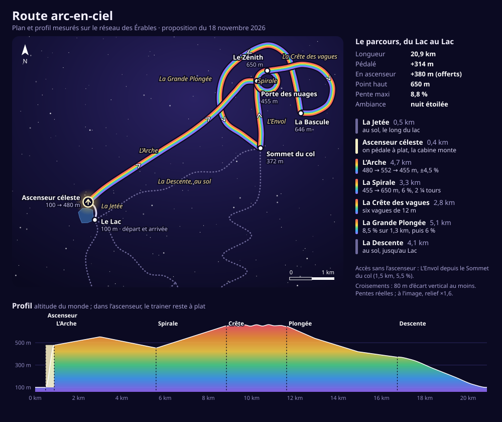
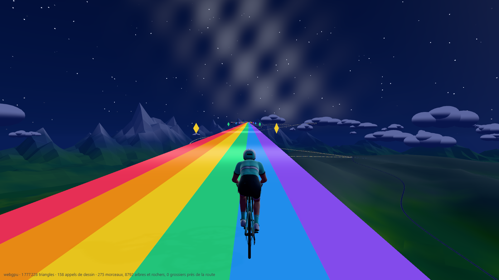
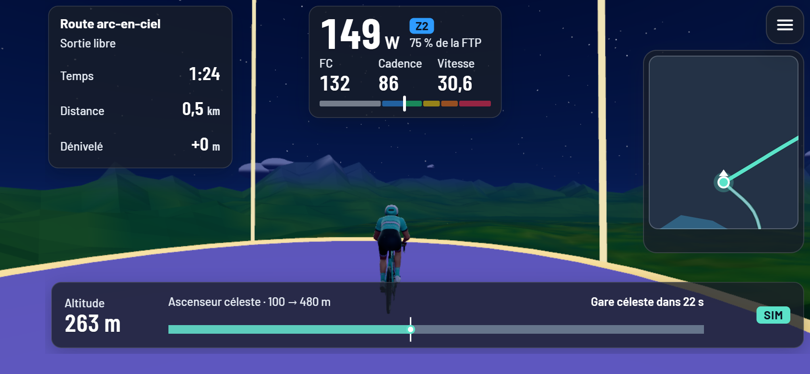

# Parcours : la Route arc-en-ciel

Spécification permanente. Proposée et construite le 18 novembre 2026. Une route de lumière suspendue dans le ciel de nuit, au-dessus du Col des Érables, où l'on monte par un ascenseur posé au bord du lac. Le document décrit le tracé, l'ascenseur, le rendu, ce qui a changé dans le moteur ([parcours.md](parcours.md)) et ce qui reste.

Code : données [`src/domain/course/courses/arc-en-ciel.ts`](../../src/domain/course/courses/arc-en-ciel.ts), rendu [`src/render/world/sky-road.ts`](../../src/render/world/sky-road.ts), tests [`src/domain/sim/lift.test.ts`](../../src/domain/sim/lift.test.ts).

Captures : [`captures/route-arc-en-ciel/`](captures/route-arc-en-ciel/) (de jour, les croisements vus de haut).

## Décisions prises

- **Dans le réseau des Érables**, pas dans un monde à part. Le trajet, les carrefours, la carte, le menu et la salle multijoueur restent tels quels.
- **Visible de jour**, pâle et translucide comme un vrai arc-en-ciel. On la voit depuis la vallée, et la colonne de l'ascenseur aussi.
- **Un ascenseur céleste** monte le cycliste depuis le Lac jusqu'au ciel.
- **La cabine monte en un temps fixe** (40 s), qu'on pédale ou non.
- **Seule la montée pédalée compte** : dans le HUD, le récapitulatif et le fichier FIT (donc Strava), les 380 m de l'ascenseur ne comptent pas.
- **Le nom** : « Route arc-en-ciel ». C'est aussi le nom français d'un circuit de Mario Kart. Le tracé, les lieux et le décor sont propres à ce monde : rien n'est repris du jeu (pas de personnage, d'objet, de musique ni de tracé). Si l'application est diffusée hors du cercle privé, le nom est à revoir ; « Ruban céleste » reste disponible.

## Le parcours

Il part du **Lac** et y revient : `guide: ['jetee', 'ascenseur', 'arche', 'spirale', 'crete', 'plongee', 'descente']`. C'est un parcours de nuit. Tout a été mesuré sur le vrai réseau des Érables, avec `RoadNetwork` et `validateNetwork`.

| Route | De → à | Longueur | Altitude | Pente |
|---|---|---|---|---|
| **La Jetée** (au sol) | Le Lac → Pied de l'ascenseur | 0,48 km | 100 m | à plat |
| **Ascenseur céleste** | Pied → Gare céleste | 0,40 km pédalés | 100 → 480 m | 0 % pour le trainer |
| **L'Arche** | Gare céleste → Porte des nuages | 4,70 km | 480 → 552 → 455 m | ±4,5 % au plus |
| **La Spirale** | Porte des nuages → Le Zénith | 3,25 km | 455 → 650 m | 6 %, régulière ; 2 ¼ tours de 230 m de rayon |
| **La Crête des vagues** | Le Zénith → La Bascule | 2,78 km | 650 → 646 m | six vagues de 12 m, de −5,9 % à +6,5 % |
| **La Grande Plongée** | La Bascule → Sommet du col | 5,11 km | 646 → 372 m | 8,5 % sur 1,3 km (8,8 % au plus), puis 6 % |
| **La Descente** (existante) | Sommet du col → Le Lac | 4,14 km | 372 → 100 m | 8,7 % au plus |
| **Boucle** | | **20,9 km** | | **+314 m pédalés**, +380 m en ascenseur |

Ce que l'on vit, dans l'ordre :

1. **Monter.** La Jetée longe le lac jusqu'à la plateforme. La cabine s'élève, le lac et la vallée rapetissent, on traverse un banc de nuages.
2. **Traverser le ciel.** L'Arche passe au-dessus de toute la vallée en dos d'âne, jusqu'à 552 m. En bas, on aperçoit la Descente que l'on prendra pour rentrer.
3. **Voir où l'on va.** Dans la Spirale, les tours suivants passent au-dessus de la tête. Depuis la Crête, on voit toute la route briller en contrebas.
4. **Tomber.** La Grande Plongée descend à 8,5 % sur 1,3 km (65 à 70 km/h) et passe sous la Crête qu'on vient de rouler.
5. **Rentrer.** Au Sommet du col, on retrouve le sol, puis la Descente ramène au Lac sous la Route arc-en-ciel.

**Les accès.**
- **L'Envol** (1,51 km, 372 → 455 m, 5,5 %) relie le Sommet du col à la Porte des nuages. C'est l'accès « à la force des jambes » pour qui a monté le Col. Le Sommet passe de deux routes à quatre (le Col, la Descente, l'Envol, la Plongée) ; elles partent à plus de 35° l'une de l'autre, et le contrôle ne relève rien.
- **Au Lac**, la Jetée devient une quatrième route. La Porte des nuages réunit l'Arche, l'Envol et la Spirale. Le Pied, la Gare, le Zénith et la Bascule n'offrent qu'une route vers l'avant et ne sont pas annoncés.

**Les croisements.** Vu d'en haut, la route passe cinq fois au-dessus d'une autre : la Spirale sur elle-même et au-dessus de l'Envol (83 m d'écart), la Crête au-dessus de la Spirale et de la Plongée (71 m et 84 m), l'Arche au-dessus de la Plongée (84 m). La Gare céleste est aussi à 380 m au-dessus du bout de la Jetée. À l'image, avec le relief ×1,6, ces écarts dépassent 110 m. Dans une première version, l'Arche ne passait que 30 m au-dessus de la Plongée. La Plongée fait donc un détour vers l'ouest (x ≈ 2 300) : elle passe de 4,7 à 5,1 km et a le temps de descendre avant le croisement.

**Géométrie, pour la saisie.** Pied de l'ascenseur et Gare céleste (−650 ; −3 200), à 100 et 480 m. Porte des nuages (2 980 ; −5 900 ; 455 m), Zénith (3 350 ; −6 130 ; 650 m), Bascule (4 100 ; −5 180 ; 646 m). La Spirale suit un tracé exact (`path`) : centre (3 350 ; −5 900), rayon 230 m, sens horaire vu du ciel, du point ouest au point nord. Les profils sont faits de pentes constantes raccordées sur 60 m. Une rampe posée telle quelle après les 20 m plats d'une extrémité donnait 9,2 % au lieu de 6 %.

## L'ascenseur céleste

### Où

Au nord du lac des Érables. La Jetée part du carrefour du Lac, longe la rive est à plus de 30 m de l'eau et finit sur la plateforme, 140 m au nord du lac. La Gare céleste est juste au-dessus, à 480 m.

### Comment il monte : en 40 s, quoi qu'on fasse

La cabine met 40 s à monter, départ et arrivée en douceur (9,5 m/s en moyenne). Le trainer reste à plat ; on peut pédaler ou souffler, la cabine ne va ni plus vite ni moins vite. Une séance en ERG continue normalement.

Dans le réseau, l'ascenseur est une route spéciale (`surface: 'lift'`) de 20 m de trajet, sans tracé en plan : la plateforme reste au pied de la colonne. Pendant la montée, `Ride` y avance au pas de la cabine (20 m en 40 s), pas à la vitesse des jambes. Avec ces 20 m, la distance du trajet ne cesse jamais de croître. La pente lissée, le fichier, le récapitulatif et la position envoyée aux autres coureurs restent donc continus, et les autres voient le cycliste monter. Ces 20 m comptent dans la distance de la sortie (20 m sur 20,5 km).

Le cycliste tourne lentement sur la plateforme en montant, du cap de la Jetée à celui de l'Arche.

Dans les deux sens : qui arrive à la Gare par l'Arche à contresens redescend de la même façon.

### Rester honnête

Les 380 m de l'ascenseur ne sont pas gagnés à la force des jambes. Le trajet distingue donc deux altitudes :

- **l'altitude du monde** (`pointAt`), pour l'image : la cabine monte réellement ;
- **l'altitude pédalée** (`altitudeAt`), celle de la simulation, du HUD, du récapitulatif et du FIT : l'altitude du monde moins ce que l'ascenseur a donné. Dans la cabine, elle ne bouge pas.

Ce que ça donne : le trainer reste à plat dans la cabine ; la montée du récapitulatif et de Strava ne compte que les 314 m pédalés. En contrepartie, l'altitude du fichier est décalée de 380 m après l'ascenseur : de retour au Lac, elle affiche −280 m. La descente rend les 380 m offerts : la Plongée et la Descente vont aussi vite que si on les avait montés, comme après n'importe quelle remontée mécanique.

### Ce que l'on voit

- **En bas** : une plateforme ronde au bout de la Jetée, cerclée de lumière, et l'arche « ROUTE ARC-EN-CIEL · ASCENSEUR » à l'entrée de la Jetée.
- **La colonne** : des anneaux de lumière tous les 20 m (à l'image), de la plateforme à la Gare, et quatre faisceaux. Les anneaux s'allument quand la cabine les passe. La cabine est un disque de verre pâle, sans parois : rien ne cache la vue. De jour, la colonne est un trait pâle, visible de loin.
- **La caméra** recule de 1,2 m à mi-montée et lève un peu le regard (1,5 m au-dessus du cycliste) : le lac et la vallée s'éloignent autour de la cabine. Sa hauteur suit la cabine sans amorti (elle monte jusqu'à 20 m/s à l'image), et le cycliste reste à plat dessus.
- **En haut**, la cabine passe par la trémie de la Gare et en devient le milieu. Elle reste en haut tant que personne ne la reprend.
- **En haut, la Gare céleste** : une plateforme plus large, bordée de lanternes, d'où l'Arche s'élance.
- **Dans le HUD**, le bandeau du bas change de sens pendant la montée ([hud.md](hud.md)) :
  - « Altitude 263 m » à la place de la pente ;
  - « Ascenseur céleste · 100 → 480 m » ;
  - une barre de progression à la place du profil ;
  - « Gare céleste dans 22 s ».

  Le dénivelé ne bouge pas. Les autres coureurs montent à leur hauteur, sans cabine à eux.

## Ce que l'on voit sur la route

### La chaussée

- **Six bandes de couleur** sur la largeur, du rouge au violet, en facettes nettes comme le reste du monde. La matière émet un peu de lumière : elle se lit dans le noir sans éblouir.
- **Une lumière qui court** le long des bandes, dans le sens de la marche, un peu plus vite que le cycliste (un trait tous les 36 m). C'est ce qui donne la vitesse, là où le sol donne d'habitude des herbes et des piquets qui défilent.
- **Le dessous** est bleu nuit, avec un liseré lumineux sur les bords : c'est ce qu'on voit de la Spirale au-dessus de soi et de la Crête depuis la Plongée.
- **Pas de garde-corps.** À la place des piquets blancs, des **balises** flottent tous les 50 m de chaque côté (petits prismes de lumière). Les bornes kilométriques deviennent des anneaux posés sur la chaussée.
- Pas d'asphalte ni de tirets. Les carrefours ont une plaque de lumière.
- **De jour**, les mêmes bandes en pastel, translucides, sans lumière propre.

### Les lieux

| Lieu | Ce qu'on y trouve |
|---|---|
| Pied de l'ascenseur | la plateforme de lumière ; l'arche du départ à l'entrée de la Jetée |
| Gare céleste | la plateforme flottante et ses lanternes |
| Porte des nuages | cinq anneaux de lumière qui se resserrent, à l'entrée de la Spirale |
| Le Zénith | un îlot de roche flottant, des cristaux à facettes, une coupole d'observatoire |
| La Bascule | un grand anneau incliné au début de la Plongée |

Aux nœuds du ciel, ni plaque d'asphalte ni poteau indicateur (`WorldLayout.skyNodes`).

Les panneaux de pente sont calculés par [`road-features.ts`](../../src/domain/course/road-features.ts) et viendront tout seuls : sur la Route arc-en-ciel, ce sont des panneaux de lumière.

### La nuit

Une ambiance `night`, à côté de `day` et `sunset` ([`ambiance.ts`](../../src/render/core/ambiance.ts)) :

- un ciel bleu nuit très foncé, des étoiles qui scintillent, dessinées par le ciel sans géométrie (`Ambiance.stars`), une bande douce de Voie lactée, et une lune au sud-est qui tient lieu de soleil (lumière froide et faible) ;
- des nuages gris-bleu éclairés par la lune. Ils flottent à la hauteur habituelle, sous la route du ciel : on roule au-dessus d'eux ;
- assez de lumière pour lire le relief et la Descente au sol ;
- `Ambiance.skyRoadGlow` règle la lumière propre de la route : 0 de jour (pastel), 0,25 au couchant, 1 la nuit.

Ce qui bouge : la lumière qui court, les étoiles qui scintillent, les anneaux de l'ascenseur qui s'allument. Tout se calcule dans la carte graphique, sauf la cabine et la couleur des anneaux.

## La physique ne triche pas

- Les pentes envoyées au trainer sont celles du tableau : 8,8 % au plus, sous le plafond de 10 %. La règle de l'ERG ne change pas.
- **Aucun bonus de vitesse.** Les chevrons de lumière au début de la Plongée sont du décor.
- L'ascenseur est à 0 % et ne compte pas dans la montée (voir « Rester honnête »).
- Pas encore de **dévers** dans la Spirale (voir « Ce qui reste »).

## Ce qui a changé dans le moteur

1. **Les routes du ciel** (`EdgeDef.surface: 'sky'`) ne portent pas le sol. `WorldLayout.edges` ne garde que les routes au sol (terrain, asphalte, bord de route, décor) ; `skyEdges` et `lifts` sont à part. Sous une route du ciel, le sol reste au moins 40 m plus bas (`skyCeiling`), puis remonte à 40 % en s'éloignant. Près du Sommet, où l'Envol et la Plongée partent du sol, cette marge s'installe sur 400 m. Le décor ne plante rien là où la route passe à moins de 30 m du sol.
2. **Des croisements à étages dans `validateNetwork`** : si l'une des deux routes est du ciel, l'écart en plan peut descendre sous 60 m tant qu'elles restent à 30 m de hauteur l'une de l'autre (`MIN_CLEARANCE_M`). Même règle pour la Spirale sur elle-même. Le réseau passe le contrôle sans défaut.
3. **L'ascenseur** (`surface: 'lift'`, `lift: { lengthM, durationS }`) : un tracé réduit à un point, une hauteur qui monte en douceur, un cap qui tourne. Le contrôle ne lui applique ni longueur minimale, ni pente, ni écart, ni angle. Le virage n'est pas arrondi à son pied ni à son sommet.
4. **Deux altitudes.** `Journey.altitudeAt` donne l'altitude pédalée : celle du monde, moins ce que les ascenseurs ont donné (`Leg.liftedM`). La simulation, le HUD, le récapitulatif et le FIT s'en servent. `pointAt` garde l'altitude du monde pour l'image. `courseStats` et l'invite de carrefour ne comptent pas la montée en ascenseur.
5. **`Ride`** avance au pas de la cabine dans un ascenseur (`Course.liftAt`), pente nulle ; `RideSnapshot.liftProgress` dit où en est la montée. `RideView` avance aussi au pas de la cabine et donne sa hauteur au monde (`World.setRide`).
6. **La carte** ([`network-map.ts`](../../src/domain/course/network-map.ts)) :
   - un filet de lumière au milieu des routes du ciel ;
   - l'ascenseur en pastille fléchée, avec ses deux altitudes ;
   - le triangle du sommet reste au Sommet du col (le point le plus haut au sol) ;
   - la planche s'allonge pour loger le quatrième profil.

   La carte de sortie ne trace pas l'ascenseur.
7. **L'accueil** a une quatrième scène dessinée, « Route arc-en-ciel » ([`home-scenes.ts`](../../src/ui/home/home-scenes.ts)).

## Interface (sortie, iPhone en plein écran)

Rien de nouveau dans le HUD. Au Sommet, l'invite de carrefour passe à trois choix (la Descente, l'Envol, la Grande Plongée à contresens) ; au Lac aussi, dont « La Jetée ». Les routes du ciel se prennent dans les deux sens, comme toute route du réseau. À vérifier en **844 × 390** : ces deux invites, et les noms les plus longs (« La Crête des vagues », « La Grande Plongée ») dans une ligne de 53 px.

Dans le menu « Rouler », la Route arc-en-ciel est une quatrième touche ; son profil se dessine à l'échelle commune du réseau, avec la marche de l'ascenseur.

## Vérifié

- Une boucle simulée à 250 W : l'ascenseur dure 39 à 40 s, l'altitude pédalée ne bouge pas dans la cabine, la montée comptée est de 314 m, le Lac affiche −280 m au retour.
- Aperçus de nuit et de jour (`node tools/preview/shoot.mjs <png> "shot=ride&course=arc-en-ciel&d=<m>"`) : Jetée (`d=380`), cabine (`d=493`), Arche (`d=1500`, de jour avec `mood=day`), Spirale (`d=6800`), Plongée (`d=11700`). Vue large : ajouter `camback=260&camup=170`.
- iPhone 13 en plein écran (844 × 390) : le menu à quatre parcours (le quatrième s'atteint en faisant défiler), la sortie sur l'Arche, et le bandeau de l'ascenseur en pleine montée, puis le retour du HUD normal à l'arrivée. Aucun texte sous 12 px, aucune cible sous 44 px. Pour revoir la montée : `node tools/mobile/check.mjs <url> <dossier> iphone13-pwa --course=arc-en-ciel --advance=80000`.

## Ce qui reste

- Le **dévers** dans la Spirale, calculé d'après la courbure, pour l'image seulement.
- Une arche « LA PLONGÉE » à la Bascule, et une cabine pour les autres coureurs.
- De jour, la route reste opaque : pastel, mais pas translucide.
- Les sons (il n'y en a pas encore dans l'application).
- **Non vérifié** :
  - la lumière qui court et la montée regardées en mouvement (jugées sur des images fixes) ;
  - la performance sur un vrai téléphone (le ruban fait environ 80 000 triangles) ;
  - le sol sous l'Arche loin du Sommet, vu de près.
