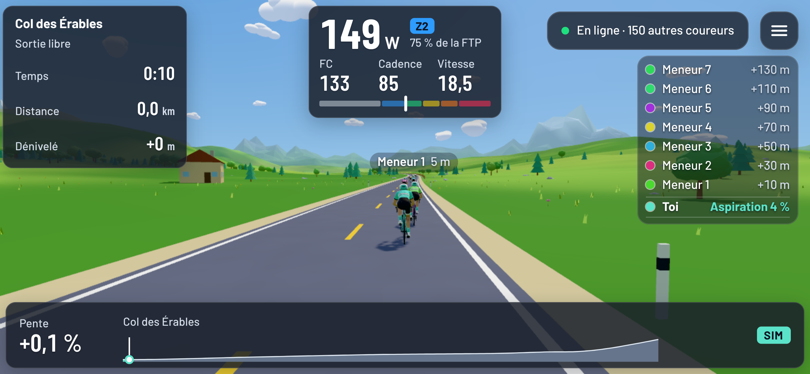

# Salle temps réel : charge et aspiration

Référence permanente de la salle (`src/server/room.ts`) et de l'aspiration (`src/domain/sim/draft.ts`). Toute évolution part de ce fichier et le met à jour. Le protocole est décrit en tête de [`src/infra/net/protocol.ts`](../../src/infra/net/protocol.ts).

## Gestion d'intérêt (17 novembre 2026)

Avant : la salle renvoyait l'instantané de **tous** les coureurs à **tous**, 4 fois par seconde. Le trafic d'un client grandissait avec la salle, celui du serveur avec son carré.

Maintenant, au-delà de `INTEREST_K + 1` = 33 coureurs actifs, chacun reçoit seulement ses **32 plus proches voisins**, dans un rayon de **1,5 km** (`INTEREST_K`, `INTEREST_RANGE_M` dans `protocol.ts`), lui exclu. En dessous, rien ne change : le même instantané pour tous, le leur compris.

- **Pourquoi 32 et 1,5 km.** La vue 3D dessine 16 coureurs à moins de 220 m ; l'encart des proches montre 7 devant et 3 derrière, jusqu'à 1,5 km ([`others-model.ts`](../../src/render/riders/others-model.ts), `NEARBY_RANGE_M`). 32 laisse de la marge au-delà des 10 de l'encart et des 16 de la vue.
- **Index spatial.** Cases de 150 m ; pour chaque destinataire on élargit les anneaux de cases jusqu'à avoir 32 voisins sûrs, dans la limite du rayon. La position du monde se calcule une fois par état reçu (`Edge.pointAt`).
- **Un coureur sans position** (pas encore d'état reçu) ne reçoit rien jusqu'à son premier état ; **sans voisin à portée**, il ne reçoit rien non plus : le client oublie les coureurs absents au bout de 5 s.
- **Ce qui reste en O(N²)** : les messages `join` et `leave` (JSON, rares) et la liste des noms envoyée à la connexion. Sans importance jusqu'à quelques milliers de coureurs ; à restreindre si la salle grossit.

### Mesures

`npm run load` : la vraie `Room`, sans réseau, N coureurs simulés, 20 ticks, médiane. Machine de développement (conteneur Linux, un seul cœur utilisé). « Réparti » : coureurs uniformes sur les 28,8 km du réseau ; « peloton » : tous sur 300 m de route, le pire cas pour l'index.

| Scénario | Coureurs | Sans intérêt : Ko/s par client | Sans intérêt : Mo/s serveur | Avec intérêt : tick (ms) | pire tick (ms) | Ko/s par client | Mo/s serveur |
|---|---:|---:|---:|---:|---:|---:|---:|
| réparti | 50 | 3,9 | 0,19 | 1,3 | 3,3 | 1,0 | 0,05 |
| réparti | 200 | 15,6 | 3,05 | 2,9 | 8,2 | 2,4 | 0,46 |
| réparti | 500 | 39,1 | 19,1 | 4,1 | 5,0 | 2,5 | 1,22 |
| réparti | 1000 | 78,2 | 76,3 | 6,2 | 11,5 | 2,5 | 2,45 |
| réparti | 2000 | 156,3 | 305,3 | 11,7 | 20,3 | 2,5 | 4,90 |
| peloton | 200 | 15,6 | 3,05 | 1,6 | 2,6 | 2,5 | 0,49 |
| peloton | 500 | 39,1 | 19,1 | 5,1 | 8,1 | 2,5 | 1,22 |
| peloton | 1000 | 78,2 | 76,3 | 14,9 | 19,4 | 2,5 | 2,45 |
| peloton | 2000 | 156,3 | 305,3 | 51,4 | 65,9 | 2,5 | 4,90 |

À lire :

- Le débit d'un client est **constant, 2,5 Ko/s (20 kbit/s)**, quelle que soit la salle : un téléphone sur une connexion faible n'est plus concerné par la taille du monde. Sans intérêt, il atteint 78 Ko/s (0,6 Mbit/s) à 1000 coureurs.
- Le serveur sort 2,45 Mo/s à 1000 coureurs au lieu de 76 Mo/s.
- Le temps de calcul d'un tick (budget : 250 ms) reste sous 20 ms jusqu'à 1000 coureurs, même en peloton ; **51 ms à 2000 en peloton** (un cas extrême : 2000 coureurs sur 300 m). Sans intérêt, le tick ne coûte presque rien en calcul (un seul tampon partagé), mais le coût passe dans les envois : 76 Mo/s.
- **Ce que cette mesure ne dit pas** : le coût réseau réel, et surtout **la capacité d'un seul Durable Object** (un par monde). Il reçoit 4 états par seconde de chaque coureur et envoie 4 messages par seconde à chacun : à 1000 coureurs, 4000 messages entrants et 4000 sortants par seconde sur un seul objet. La limite réelle de Cloudflare est à mesurer avec de vrais clients sur un aperçu de branche (`npm run bots` contre un aperçu) avant d'annoncer une capacité. Au-delà, il faudra répartir le monde en plusieurs objets (par zone du réseau).

## Rouler avec d'autres : coût des messages (20 novembre 2026)

Les messages de la liste « En ligne » et des groupes ([groupe](groupe.md)) ne passent pas par le tick : chacun est traité quand il arrive. `npm run load` les mesure aussi (second tableau) : la vraie `Room`, sans réseau, 200 coureurs différents qui demandent « qui est en ligne » (une demande par seconde et par coureur au plus), puis des choix de route diffusés à un groupe de 30 et des arrivées dans un groupe.

| Coureurs | `who` (ms) | pire `who` (ms) | réponse `who` (octets) | choix de route à 30 membres (ms) | arrivée dans un groupe (ms) |
|---:|---:|---:|---:|---:|---:|
| 1000 | 0,19 | 0,68 | 2746 | 0,014 | 0,022 |
| 2000 | 0,44 | 1,28 | 2800 | 0,012 | 0,022 |
| 5000 | 0,91 | 2,52 | 2800 | 0,010 | 0,021 |

À lire :

- **`who` parcourt toute la salle** (filtre par nom, tri), donc son coût grandit avec elle : environ 0,2 ms à 1000 coureurs, 0,9 ms à 5000. La réponse est bornée (30 coureurs et les groupes ouverts, environ 2,8 Ko).
- **Le panneau « En ligne » rafraîchit toutes les 5 s** tant qu'il est ouvert : si la moitié de 2000 coureurs l'ouvrait en même temps, ce serait 200 demandes par seconde, soit 90 ms de calcul par seconde sur l'objet (9 %). Le plafond d'une demande par seconde et par coureur borne le pire cas à 2000 demandes par seconde, soit 88 % : il ne peut pas arriver avec un panneau qui se rafraîchit toutes les 5 s, mais ce serait à surveiller (une réponse gardée une seconde en cache le ramènerait à une par seconde pour toute la salle).
- Le choix de route d'un créateur et l'arrivée d'un membre coûtent quelques centièmes de milliseconde : rien à craindre à 30 membres.
- Comme pour le tick, **ce tableau ne dit rien de la capacité réelle d'un Durable Object** (messages entrants, écritures de stockage à chaque changement de groupe, hibernation) : à mesurer avec de vrais clients sur un aperçu de branche.

## Aspiration (17 novembre 2026)

Derrière un autre coureur, on économise une part de la **traînée de l'air** (le roulement et la gravité ne changent pas). Calcul du côté de chaque client avec les coureurs qu'il reçoit : le serveur ne simule rien.

`économie = 0,35 · exp(−écart / 6 m)`, où l'écart est celui entre la roue avant du suiveur et la roue arrière du meneur (distance de centre à centre moins 1,8 m).

| Écart de roues | Économie d'air |
|---:|---:|
| 0,2 m | 34 % |
| 1 m | 30 % |
| 5 m | 15 % |
| 10 m | 7 % |
| 20 m | 1 % |

Les ordres de grandeur viennent de la littérature (soufflerie et simulation de peloton : environ 30 à 40 % de traînée en moins pour le deuxième coureur à une roue, de l'ordre de 10 % vers 10 m). **Ce ne sont pas des mesures de notre part : à régler à l'usage.**

Qui compte comme meneur ([`draft.ts`](../../src/domain/sim/draft.ts)) : un coureur dont la sortie est en cours, plus rapide que 2 m/s, **devant** à moins de 25 m, dans la même file (écart latéral d'au plus 2,5 m), allant dans le même sens (écart de cap d'au plus 30°). Seule la meilleure aspiration compte : pas de bonus de file, pas de vent.

Effets :

- À 250 W sur le plat (coureur de 80 kg, calcul du modèle), 30 % d'air en moins fait passer de 37,1 à 41,5 km/h ; à 150 W, de 30,7 à 34,2 km/h. En côte raide, l'air pèse peu : l'aspiration aide peu (à 2 m/s en 10 %, moins de 2 % de la résistance).
- Le trainer n'est pas touché : sa résistance suit la pente (SIM) ou la consigne (ERG) ; seule la vitesse virtuelle change, comme dans les autres applications.
- L'encart des proches montre « Aspiration 23 % » en vert sur la ligne « Toi » à partir de 3 %.
- Rien n'est envoyé au serveur : l'aspiration est une conséquence de ce que chaque client voit.

Pas fait (volontairement) : aspiration à plusieurs de front ou en file longue, vent, aspiration derrière les coureurs de devant par une route différente (carrefour : le cap et l'écart latéral le gèrent grossièrement), et tout contrôle côté serveur (un client qui tricherait sur sa vitesse est borné par `MAX_SPEED_MS`).

| | |
|---|---|
| Aspiration derrière des coureurs devant, téléphone couché 844 × 390 (150 coureurs sur place : l’encart n’en montre que 7 devant) |  |
