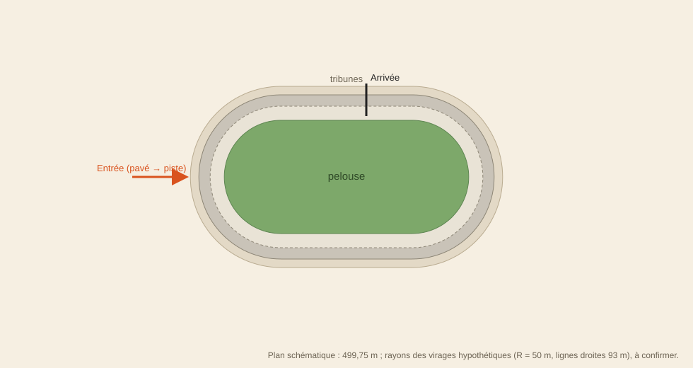

# Parcours : le vélodrome de Roubaix

Proposition de design du 18 novembre 2026. Rien n'est construit : ce document cadre ce que serait un parcours dans le vélodrome André-Pétrieux, ce qui change par rapport au monde des Érables ([parcours.md](parcours.md)), et les décisions à prendre.

## Ce que l'on sait du lieu

| Donnée | Valeur | Fiabilité |
|---|---|---|
| Longueur de la piste | 499,75 m, béton | [Wikipédia FR](https://franco.wiki/fr/V%C3%A9lodrome_Andr%C3%A9-P%C3%A9trieux.html) ; « 500 m » ailleurs |
| Arrivée de Paris-Roubaix | depuis 1943, sauf 1986 à 1988 | [Wikipédia EN](https://en.wikipedia.org/wiki/Roubaix_Velodrome) ; 1942 selon le ministère de la Culture |
| Arrivée sur la piste | environ un tour et demi avant la ligne | [Rouleur](https://www.rouleur.cc/blogs/the-rouleur-journal/through-the-keyhole-transfixed-by-the-magic-of-roubaix-for-the-first-time) |
| Inclinaison des virages | **15,4° ou 31° selon les sources** | **à confirmer** (le 44,3° de Komoot est celui du vélodrome couvert voisin) |
| Largeur de piste, rayons, longueur des lignes droites | inconnus | à relever sur plan ou photo |

Le plan ci-dessus est schématique : rayons de virage (50 m) et lignes droites (93 m) sont des hypothèses qui donnent la bonne longueur, pas des mesures.

## Ce qui change par rapport aux Érables

1. **Une boucle fermée et plate.** Pas de pente à envoyer au trainer : toujours 0 %. L'interface `Course` ([`course.ts`](../../src/domain/course/course.ts)) et la classe `Route` ([`route.ts`](../../src/domain/course/route.ts), boucle à segments, dénivelé net nul) suffisent pour la simulation, l'export FIT et le récapitulatif. Aucun nouveau modèle physique.
2. **Pas de carrefour.** Le réseau routier (`RoadNetwork`) impose des routes d'au moins 150 m entre deux nœuds, pas de cul-de-sac, un angle minimal aux carrefours : une piste de 500 m qui se referme sur elle-même n'est pas son cas. Un vélodrome n'a donc **pas besoin d'être une route du réseau** ; en revanche le multijoueur situe les coureurs par route et abscisse (`NetPosition`). À trancher, voir « Décisions ».
3. **Un monde à part.** Le décor, le sol et les routes sont déduits du réseau des Érables ([`world-layout.ts`](../../src/render/world/world-layout.ts)). Un vélodrome est une scène propre : piste inclinée, tribunes, pelouse centrale, ciel. Peu de géométrie, donc peu de coût.
4. **La pente n'est pas l'effort.** Ce qui rend la piste intéressante est ailleurs : le rythme (tours chronométrés), la ligne et les virages, la foule, l'attaque finale.

## Trois propositions

### A · Piste seule : les tours

Une scène dans le vélodrome, un tour de 500 m répété. Tours chronométrés, meilleur tour, écart au tour précédent, nombre de tours dans le HUD. Idéal pour tenir une puissance (comme la Rive du lac) : rythme régulier, aucun relief.

- Pour : le plus simple. Une `Route` de 500 m, une scène, un compteur de tours.
- Contre : monotone seul, et ne dit pas pourquoi *Roubaix*.

### B · L'arrivée de Paris-Roubaix (recommandée)

Les derniers kilomètres jusqu'à la piste, puis **un tour et demi** pour l'arrivée. L'entrée sur la piste est le moment fort. Le récit se joue en trois temps :

1. **L'approche** (3 à 5 km) : secteur pavé puis rues de Roubaix, en pente nulle. Rue, usine de brique, public derrière les barrières.
2. **L'entrée** : rampe courte vers l'intérieur de la piste, la foule dans les tribunes, un son de rumeur qui monte.
3. **Le tour et demi** : cloche du dernier tour, puis ligne. Récapitulatif avec le temps des 1,5 tours et le classement sur la ligne d'arrivée.

Se combine bien avec une séance : les 3 à 5 km d'approche sont un bloc d'effort à tenir, et l'arrivée est un `MaxEffort` de 1,5 tour (le palier libre existe déjà dans les séances).

- Pour : c'est l'identité du lieu. Le seul parcours qui raconte quelque chose.
- Contre : il faut dessiner l'approche (rues, pavés), donc un morceau de réseau routier en plus de la scène de la piste, et un raccord entre les deux scènes.

### C · Poursuite en peloton

Piste seule (comme A), mais avec les autres coureurs de la salle sur la même boucle, à plusieurs de front, aspiration comprise ([salle.md](salle.md)). Une course aux points ou une poursuite par équipes.

- Pour : tire parti du multijoueur existant, et une boucle étroite rassemble les coureurs.
- Contre : la salle suppose une route et une abscisse ; à 4 Hz, de nombreux coureurs sur 500 m c'est le pire cas de l'index (voir `npm run load`, « peloton »). Dépend du choix sur `NetPosition`.

**Recommandation** : A comme base (scène et compteur de tours), B comme but (l'arrivée de Paris-Roubaix), C plus tard. A est une marche de B, donc la scène du vélodrome se construit une seule fois.

## La scène

- **Piste inclinée** : bande de béton clair avec la ligne de côtière (bleue), la ligne des sprinters (rouge) et la ligne de poursuite (noire), les virages relevés (angle à confirmer). Le coureur monte dans le virage à l'image ; la pente envoyée au trainer reste 0 %.
- **Caméra** : celle de [`ride-feel.ts`](../../src/render/core/ride-feel.ts), avec un roulis dans les virages (comme le balancement de pédalage) pour suivre l'inclinaison.
- **Lieux** : tribunes, pelouse centrale, arche d'arrivée, panneau « Vélodrome André-Pétrieux · 499,75 m ». Les douches du vélodrome, où les vainqueurs de Paris-Roubaix voient leur nom gravé sur une plaque, sont un détail qui parle aux connaisseurs : à vérifier avant de l'inclure.
- **Ambiance** : un parcours porte une `ambiance` ([`ambiance.ts`](../../src/render/core/ambiance.ts)). Proposition : lumière d'avril, ciel du nord, plus gris que le Col des Érables.
- **Ce qui bouge** : drapeaux, foule (instances animées en carte graphique, sur le modèle des arbres), les autres coureurs.

## Interface (sortie, iPhone en plein écran)

Mise en page contrôlée pour **844 × 390**, le plein écran de l'iPhone 13 en paysage, selon la consigne du dépôt. Le HUD de la Sortie ([sortie.md](sortie.md)) garde ses emplacements. Pour la piste :

- en haut à gauche : au lieu du nom du parcours seul, **tour N / M** et le temps du tour courant ;
- au centre : puissance, FC, cadence, vitesse, comme aujourd'hui ;
- en bas : au lieu du profil d'altitude, qui serait une ligne plate, **un anneau** (miniature de la piste) avec la position du coureur et celle des autres ;
- l'encart des coureurs et la carte : l'anneau remplace la carte routière ; pas de carrefour, donc pas d'invite de choix ;
- dernier tour : bandeau « Cloche » et décompte de la distance restante.

## Décisions à prendre

1. **Le vélodrome dans le réseau ou à part ?** Dans le réseau : il faudrait autoriser une route dont les deux extrémités sont le même nœud, et assouplir `validateNetwork` (angle de carrefour, séparation d'une route avec elle-même). À part : une scène et un parcours indépendants, avec leur propre notion de position pour le multijoueur. **Recommandation : à part**, avec un type de position « tour et abscisse » dans le protocole ; un réseau routier pour l'approche de B viendrait plus tard, avec la scène de la piste pour dernier nœud.
2. **Quelle portée pour la première version ?** A seule (une boucle et un compteur de tours), ou A et B ensemble. Recommandation : A d'abord.
3. **Données du lieu.** Relever l'inclinaison réelle, la largeur de la piste et les rayons, et savoir de quel côté se trouvent la tribune et la ligne d'arrivée. Source à trouver (plan, relevé, photos) ; sans elle on dessine un vélodrome de 500 m plausible.
4. **Le nom et les images.** Un lieu réel, des images de course et des noms de champions : on dessine tout nous-mêmes, sans photo de tiers ni logo de la course.

## Ce qui n'est pas traité

- L'approche de B : tracé réel des derniers secteurs pavés, à documenter avant de le dessiner.
- La sensation du pavé. Le trainer ne reproduit rien d'autre que la résistance ; il reste le son, la caméra qui tremble un peu, et rien dans le HUD.
- Des vues de référence du vélodrome pour `tools/preview/shoot.mjs` et une validation sur 844 × 390.
