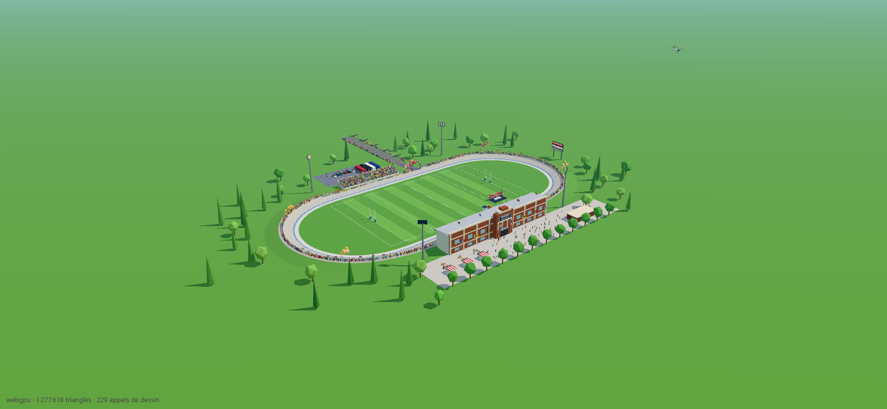
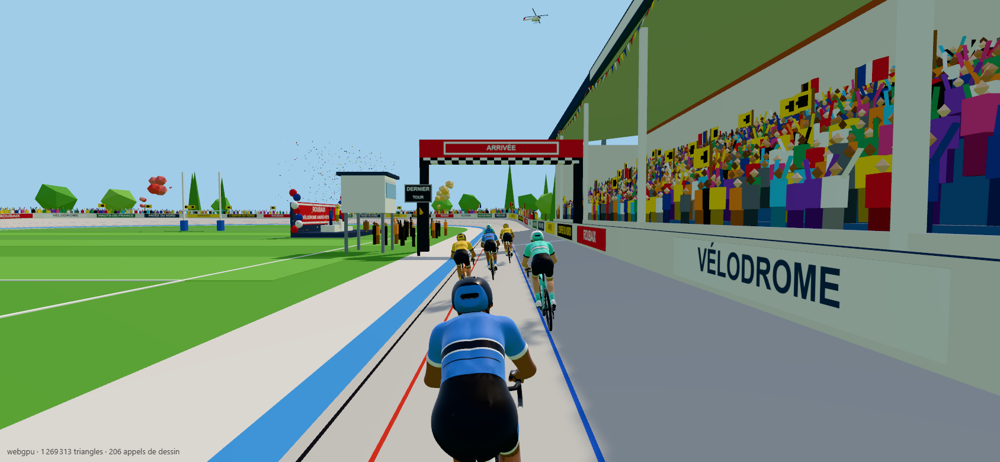
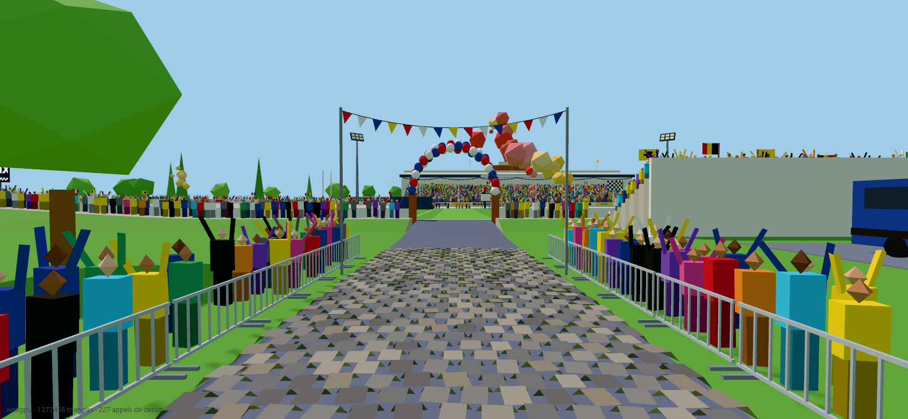

# Vélodrome de Roubaix

Spécification permanente. Créée le 17 novembre 2026 : le vélodrome est préparé seul, avant le parcours qui l'empruntera.

**Dans le monde** depuis le 17 novembre 2026 : à l'est du Moulin, par l'Allée du Vélodrome ; on y tourne autant qu'on veut et on ressort par la porte (voir [parcours.md](parcours.md#le-vélodrome)). La porte des coureurs est perpendiculaire à la piste (elle était à 50° dans la première version) : on y entre et on en sort par un virage à droite.

## Pourquoi

Une route qui finit, comme Paris-Roubaix, par un tour et demi de piste dans le vélodrome André-Pétrieux. Le modèle reste aussi fidèle que possible au vrai, dans le style à facettes du jeu.

## Ce qui est fidèle

| | Réel | Modèle |
|---|---|---|
| Piste | béton, découverte, 499,75 m à la corde | idem, mesuré sur la ligne de mesure (test) |
| Largeur | 6 m | 6 m, plus une bande bleue de 0,7 m au pied |
| Dévers | 15,4° dans les virages | 15,4° ; 6° en ligne droite (valeur supposée) |
| Tracé | deux lignes droites, deux virages | lignes droites de 86 m, raccordements progressifs de 28 m, arcs de 43 m de rayon |
| Pelouse | terrain de rugby | terrain aux dimensions qui tiennent (lignes, en-buts, poteaux) |
| Capacité | environ 2 000 places | tribune couverte de 14 rangs sur 80 m, gradins découverts de 9 rangs sur 48 m |

Sources : la fiche Wikipédia du vélodrome et ses reprises (longueur, largeur, dévers, 1936, rugby, capacité). Les lignes droites, le dévers des lignes droites et la disposition des tribunes ne sont pas publiés : ils sont estimés.

## Ce qu'on y trouve

- **Piste** ([`src/domain/course/velodrome-track.ts`](../../src/domain/course/velodrome-track.ts), sans Three.js) : bande bleue, béton clair, ligne de mesure noire à 20 cm du bord, ligne des sprinteurs rouge à 85 cm, ligne des stayers bleue à 2,45 m de la ligne de mesure. On tourne à gauche. `VelodromeTrack.point(s, u)` donne tout point de la piste (`s` le long de la ligne de mesure depuis le milieu de la ligne droite d'arrivée, `u` en travers depuis le pied de la bande bleue).
- **Ligne d'arrivée** devant la tribune (bande blanche, trait noir), cabine des juges sur pilotis côté pelouse.
- **Bord extérieur** : mur blanc de 1,1 m à couvertine bleu nuit, coursive en béton, puis talus d'herbe à 25 %.
- **Tribune couverte**, ligne droite d'arrivée : gradins béton et bancs bleus, toit en pente sur poteaux, bandeau « Vélodrome André-Pétrieux » face à la piste. Côté ville, façade Art déco en brique : bandeaux et pilastres clairs, pavillon d'entrée à gradins avec son enseigne.
- **Gradins découverts**, ligne droite opposée, avec leurs barrières.
- **Porte des coureurs** sur la ligne droite opposée : une rampe en enrobé arrive en biais (50°) dans le sens de la course, entre deux piliers de brique, au bout d'une route d'accès de 110 m. C'est là que se branchera le parcours (`Velodrome.gate`).
- **Les douches** derrière la tribune, bâtiment bas en brique ; parvis bordé de platanes.
- Quatre **mâts d'éclairage**, des **peupliers d'Italie** et des feuillus autour du parc.

Code : [`src/render/world/velodrome.ts`](../../src/render/world/velodrome.ts), un seul maillage à facettes (le `Kit` des lieux) plus trois enseignes.

**Finesse du maillage** (18 novembre 2026) : à grande vitesse, les traits peints au sol laissaient voir le tracé en lignes droites (bandes de 2 m, soit 2,7° de cap d'une bande à l'autre dans les virages de 43 m de rayon). Le tour est maillé tous les 0,5 m (`LAP_STEP_M`, 0,7°), les bâches du mur par 1 m, et les normales du sol sont adoucies (`softenNormals`, arêtes de plus de 5° conservées) pour qu'aucune bande d'ombrage ne marque le pas du maillage. Coût : environ 28 000 triangles de plus.

## Un jour d'arrivée

Ajouté le 17 novembre 2026 (seconde passe). Code : [`src/render/world/velodrome-fete.ts`](../../src/render/world/velodrome-fete.ts).

- **Le public**, environ 3 400 spectateurs : la tribune comble, les gradins, deux rangs contre le mur des virages, derrière les barrières de la route d'accès, sur le parvis, autour des bus. Corps et têtes en instances ; un tiers lève les bras.
- **Drapeaux** brandis dans le public et hissés devant la façade et sur la tribune : Lion de Flandre (le plus nombreux), France, Belgique, damier.
- **Le dernier secteur pavé** : la route d'accès finit en pavés sur 80 m (le vrai secteur, Espace Crupelandt, mène au vélodrome), bombés au centre, de teintes et de tailles variées, entre deux rangs de **barrières Vauban** et de spectateurs, sous des fanions tendus en travers.
- **Arche de ballons** bleu-blanc-rouge sur la porte des coureurs.
- **Portique d'arrivée** rouge à damier et banderole « Arrivée » ; **tableau des tours** (« TOURS » et le nombre de tours bouclés par le joueur) **et sa cloche**, qui sonne à chaque tour, côté pelouse.
- **Podium** sur la pelouse : trois marches, les trois premiers bras levés, le **pavé** en trophée sur son socle, fond « Roubaix », colonnes de ballons et pluie de **confettis**. Photographes et officiels sur la bordure, après la ligne.
- **Fumigènes** rouges et jaunes dans le public des virages.
- **Écran géant** derrière le premier virage, qui fait défiler « Roubaix », les tours bouclés par le joueur et le temps de course qui tourne.
- **Bâches** tout autour du mur : « Roubaix », « L'enfer du Nord », « Arrivée », « Pavés du Nord », « Hauts-de-France », « Vélodrome ». Aucune marque réelle.
- **Parvis** : baraques « Frites », « Gaufres », « Buvette » à toit rayé, files d'attente, tables de pique-nique, promeneurs.
- **Parking des équipes** derrière les gradins : quatre bus, six voitures à vélos sur le toit, mécaniciens.
- **Hélicoptère de la télévision** qui tourne au-dessus du vélodrome.

**Ce qui bouge.** Dans la carte graphique (`time` de TSL, aucun coût par image côté processeur) : le public saute et se balance, chacun à son rythme, les bras levés s'agitent ; les drapeaux ondulent depuis la hampe ; les fanions se balancent ; les ballons flottent ; les confettis tombent en voletant ; les fumigènes montent, gonflent, dérivent avec le vent et se dissipent. Par image (`Velodrome.update`) : l'hélicoptère et son rotor, la cloche qui sonne, l'écran géant redessiné deux fois par seconde.

**Coût.** Environ 195 000 triangles pour tout le vélodrome, dont 120 000 pour le public (sans ombre portée), 26 000 pour les pavés et 18 000 pour les installations de la fête ; une vingtaine d'appels de dessin. Les six coureurs de l'aperçu pèsent bien plus que le décor. `budget` dans l'aperçu détaille les parties.

## Aperçu

`node tools/preview/shoot.mjs <sortie.png> "shot=velodrome&view=<vue>"`, vues `aerial`, `porte`, `tribune`, `piste`, `virage`, `entree`, `facade`, `podium`, `parking`. Le vélodrome est posé seul sur une prairie, sous la lumière de jour du jeu, avec six coureurs penchés selon le dévers qui tournent sur la piste. `anim=0` les fige, `t=4` avance l'animation du décor de 4 s avant la photo (confettis et fumigènes en l'air), `budget` affiche les triangles par partie. Captures : [`captures/velodrome/`](captures/velodrome/).

## Ce qui reste

- Un **parcours façon Paris-Roubaix** (du Village au vélodrome, puis un tour et demi) : le parcours « Vélodrome » ne fait que tourner sur la piste. Un parcours doit revenir à son départ en prenant chaque route dans son sens : il faudrait autoriser l'allée à contresens dans un parcours, ou une route de retour.
- La caméra ne se penche pas avec le dévers (choix : seul le coureur se penche, l'image reste stable).
- Le public ne réagit pas au passage du joueur ; personne ne franchit réellement l'arche « Arrivée » (pas de classement, pas de compte des tours).
- Le dessous du toit de la tribune prend la couleur verte de la lumière du sol.
- Non vérifié : la performance sur téléphone (le public est le premier poste à réduire, par exemple un spectateur sur deux en profil bas), le vélodrome vu de loin dans un vrai relief, l'animation regardée en mouvement (jugée sur des images fixes à différents instants).
- Le public ne suit pas les coureurs du regard et ne réagit pas à leur passage. Aucun son : l'application n'en a pas encore (cloche, public et hélicoptère sont muets).
